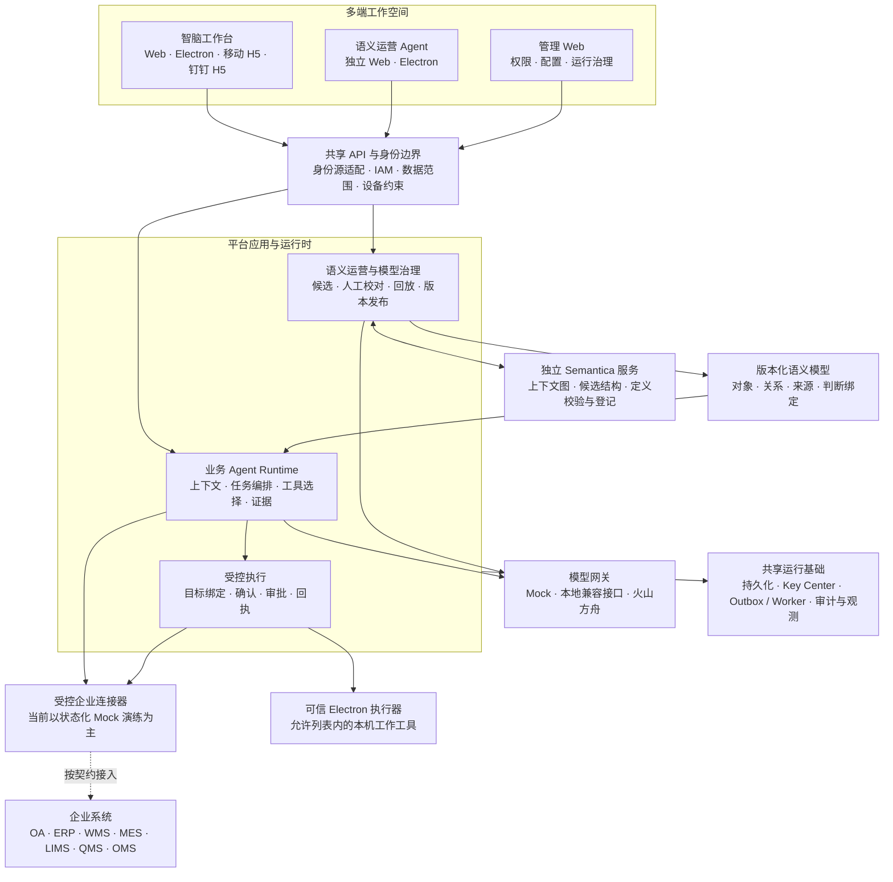

<div align="center">

# 元域智脑 · Yuanyu Zhinao

### 以语义层连接企业数据，以 Agent 承接业务与工作

2026-09-13 第五批：项目已通过专用只读 Key 接通本机 WeKnora 合成库，双端真实检索/引用回读/身份隔离及混合检索通过；两端各三轮方舟问答通过，实际订单和金额不足时明确未知。修复有效分块状态误判、摘要误作原文候选和检索诊断标记。范围仅合成库，实时业务联合规划仍未完成。[最新验收与剩余项](docs/development/WEKNORA_UPGRADE_ACCEPTANCE.md)。以下旧批次保留历史状态。

最新第四批：来源约束的连续问答、模型 Wiki 草稿、历史恢复、多模态人工校对已加入双端知识工作区。模型只选来源片段，服务端回填原文；真实方舟四个合成用例通过。项目 WeKnora Key/映射和实时业务联合规划仍待完成。[操作与边界](docs/guides/KNOWLEDGE_WORKSPACE_GUIDE.md) · [第四批验收](docs/development/WEKNORA_UPGRADE_ACCEPTANCE.md)。

2026-09-12 知识工程增量：[双端知识工作区](docs/guides/KNOWLEDGE_WORKSPACE_GUIDE.md)支持资料校对、来源复验、理解草稿和长期目标修正；WeKnora 独立合成库三轮真实问答通过。项目外部 Key/资源映射尚未启用，不将独立实例的成功表述为全链路已接通。[验收与剩余范围](docs/development/WEKNORA_UPGRADE_ACCEPTANCE.md)。

最新进展：[全链路双 Agent 修复与回归](docs/development/SUPPLY_CHAIN_INCIDENT_REPAIR.md)覆盖采购、生产拆合批、仓配、门店、订单、财务和人员；新增逐跳授权的后代展开、按证据解释、有界多根比较和附件跨轮检索。完成范围限于声明模型，不将局部核验包装为全企业实时真相；[修复前证据](docs/development/SUPPLY_CHAIN_INCIDENT_EVALUATION.md)原样保留。

2026-09-12：已发布模型解释改为“模型选择引用、服务端校验填值”，区分实际事实、计算指标、证据缺口与待验证建议；拒绝伪造字段、旧快照和不存在的引用。契约和使用边界见 [发布模型接入指南](docs/guides/PUBLISHED_MODEL_WORKBENCH.md)。

企业级 AI 工作台与语义运营平台

**双 Agent 协同 · 企业本体建模 · 多模态交互 · 受控任务执行 · 多端工作空间**

[产品定位](#产品定位) · [核心能力](#核心能力) · [系统架构](#系统架构) · [快速开始](#快速开始) · [文档中心](docs/README.md)

</div>

---

## 产品定位

企业已经拥有大量系统、数据和流程，真正困难的是让它们围绕一个业务问题协同工作：一条质量异常关联哪些批次与订单？库存数字采用什么口径？谁可以读取证据，谁可以发起处理，怎样确认动作确实完成？

**元域智脑围绕“理解诉求 → 关联语义 → 获取证据 → 受控执行 → 追踪结果”建设企业 Agent 能力。** 员工用自然语言提出需求，业务智脑在授权范围内分析和协作；运营人员通过独立 Agent 构建语义模型，让分散在不同系统中的对象、字段与关系拥有可管理的业务定义。

项目面向企业私有化部署与系统集成场景，兼顾业务协同和日常工作辅助。推理侧提供本地兼容接口与火山方舟适配，可依据模型能力、数据分级和出网要求选择运行方式。

> **当前阶段：开发基线与可运行的 Mock 验证平台。** 仓库包含多端应用、Agent Runtime、语义建模、权限治理和测试工程；真实企业连接器、基础设施与生产验收仍按清单推进。使用云端模型时，允许的上下文会发送至模型服务，私有化应用部署不等于完全离线推理。

2026-09-10 [复杂业务闭环修复](docs/development/SEMANTIC_WORKBENCH_LOOP_REPAIR.md)：语义建模、人工审阅读计划、正反例回放、Semantica 发布与智脑只读消费已在隔离真实 HTTP/方舟链路打通。18 类对象按显式外键查询，A/B 规则变化影响计算，未发布草稿不影响答案。规则仍需人工确认，默认不授予数据权限；不是任意自然语言业务自动上线。见 [配置指南](docs/guides/PUBLISHED_MODEL_WORKBENCH.md)。

### 平台交付的三类价值

| 价值 | 平台如何承接 |
| --- | --- |
| **让业务诉求进入可追踪的工作流程** | 将连续对话、材料理解、查询分析、待确认动作与执行回执放在同一工作空间中 |
| **让企业数据具有可复用的业务含义** | 统一对象、主键、粒度、字段、关系、来源和口径，保留模型版本及证据关联 |
| **让 Agent 的能力与权限一起增长** | 工具注册、身份映射、数据范围、用户确认、审批与审计共同约束执行边界 |

## 双 Agent 产品体系

平台将业务使用与语义建设分为两个独立的 Agent 入口，并提供管理 Web 作为权限与运行管理界面。

| 入口 | 面向人群 | 核心职责 | 产品形态 |
| --- | --- | --- | --- |
| **智脑工作台** | 业务人员、管理者、知识工作者 | 智能对话、材料分析、业务查询、任务协同、受控桌面工作 | Web、Electron、移动 H5、钉钉 H5 |
| **语义运营 Agent** | 业务建模、数据治理与运营人员 | 需求讨论、字典解析、候选建模、可视化校对、模型版本与巡检 | 独立 Web、独立 Electron |
| **管理 Web** | 平台管理员与实施人员 | 权限、配置、运行情况及治理管理；语义层作为独立模块呈现 | Web |

两类 Agent 共享服务端基础设施，但保留各自的任务语义与授权范围。业务登录资格不等于模型发布权限；语义模型的编辑权限也不等于采购、库存或审批的业务操作权限。

## 核心能力

### 01 · 对话式工作空间

- **连续对话与目标修订**：承接编号、材料、条件补充和事实更正，让用户能够在同一任务中持续推进问题。
- **多任务会话**：任务新建、切换与归档，分别保留消息和状态，避免不同任务相互污染。
- **分层上下文与可撤销记忆**：会话历史、摘要、结构化索引及用户主动固定的长期目标共同服务后续交互。
- **可见的执行过程**：展示理解、鉴权、证据读取、建议、确认、排队与回执，而非用一句“已完成”代替真实状态。

上下文受长度和权限限制；长期目标需要用户主动固定，记忆不会自动转化为业务授权。工作流学习采用经授权的最小化信号，不等于自动训练模型权重。

### 02 · 多模态材料理解

支持受控接入文本、结构化字典、办公文档与图像，将材料理解纳入任务上下文。

| 材料 | 主要用途 |
| --- | --- |
| JSON / YAML / CSV、受支持的 OpenAPI Schema | 数据字典、字段定义、对象引用和来源结构 |
| DOCX / XLSX | 文档正文、表格、行列与字段对应关系 |
| PDF | 文本材料，以及依赖解析、视觉适配的扫描或混合页面 |
| PNG / JPEG / WEBP | 关系图、截图与图像材料的受控理解 |

两端提供附件读取范围，提示截断、隔离和未识别内容。图片理解依赖可用模型、安全准入与出网配置；音视频及任意复杂文档的完整理解不在当前验收范围。

### 03 · Agent 辅助的语义层建设

语义层是平台的核心模块，将“业务说法”整理为可以编辑、校验和版本化的模型定义。

- **候选生成**：从自然语言、数据字典及受控来源结构提取对象、字段、主键与关系候选。
- **可视化人工校对**：对象关系画布与属性编辑联动，校对来源、主键、映射、类型、方向及关系基数。
- **业务本体表达**：区分主数据、批次、库存项、交易和事件粒度，补充状态、关系证据及有效期。
- **语义资产治理**：维护业务术语、指标、数据契约、质量规则、访问策略与血缘定义。
- **版本化交付**：草稿、结构校验、样本回放、差异与影响查看、发布登记及草稿快照恢复。

**Semantica** 作为独立语义服务，提供上下文图、受控候选发现及模型定义校验/登记路径。候选结构、人工草稿、发布定义与图中事实分别管理，来源不明确的候选必须保留待核实状态。

制造案例已验证跨 6 个系统的材料保真、分批建模与候选建图：13 类对象、17 条类型关系，19 条样本形成26条实例边；需求约束以带证据的候选资产保留，不自动获得执行权限。详见[材料建模指南](docs/guides/SEMANTIC_MATERIAL_WORKSPACE.md)与[修复回归报告](docs/development/SEMANTIC_MANUFACTURING_REPAIR.md)。

### 04 · 可检验的判断与样本回放

平台将部分业务判断实现为已注册、精确版本化的只读能力，使字段适配与判断参数可以被单独检查。

- 质量处置判断区分待确认、处理中、已审批与已关闭，不将审批当作业务完成。
- 字段映射、参数、状态与关系定义参与模型指纹；配置变化后，旧回放与构建结果不能代替新版本验收。
- 授权样本回放比较草稿与已发布定义，可配置发布人必须完成当前指纹的回放。
- 有界关系历史样本支持业务有效时间、记录时间、修订、撤回与基数冲突检查。
- 显式跨系统编号映射按来源命名空间、类型与粒度核验，不凭同名或同号自动合并对象。

最新开发快照还包含库存快照判断和枚举值转换配置，其新增场景专项测试与界面回归仍待补齐。样本核验不代表已接入企业全量历史、权威主数据注册库或实时库存系统。

### 05 · 受控业务与桌面执行

业务侧通过已注册工具承接查询分析和待审批草稿；可信 Electron 端提供受限的文件生成、工作区文本读取、HTTPS 打开与剪贴板写入能力。

**执行结果由服务端和端侧回执共同确认。** 模型建议、用户确认、审批通过、任务派发、执行成功分别保留状态；尚未写入电脑或外部系统时，不能报告操作已完成。

本机文件工具可面向桌面、文档或下载目录下的受控工作区新建文本、Word 与表格。当前不是任意电脑控制，不开放任意终端命令、任意应用操作、文件覆盖或删除。

### 06 · 企业身份、数据与模型治理

- **统一身份适配**：钉钉及多 OIDC 身份源通过明确账号绑定进入平台 IAM。
- **分层访问控制**：结合租户、主体、角色、组织数据域、任务和设备约束访问，不信任客户端自报权限。
- **模型访问治理**：模型允许列表、凭据引用、脱敏上下文与附件准入共同控制推理请求。
- **受控工具调用**：工具 Schema、目标绑定、权限检查与一次性确认限制动作范围。
- **证据与运行治理**：执行追踪、审计、Outbox、后台 Worker、健康检查和观测工具支撑问题定位。

钉钉手机与 PC 共用 H5 工作台已有接入实现；企业免登、真实成员和真机仍需联调。企业微信、飞书等国内平台已有接入指南，不能据此视为全部专用适配器已实现。

## 系统架构

以下为逻辑架构；企业系统框表示连接器的接入目标，不表示当前已连接生产环境。



### 三个关键设计选择

**语义与权限分离。** 语义模型描述对象如何关联、字段意味着什么；IAM 决定谁可以读取或操作。建立一条关系不会扩大用户的数据范围。

**推理与副作用分离。** 模型负责理解与建议，受控运行时负责工具准入和执行约束。仅分析问题不会自动生成业务申请，历史聊天也不能代替本次确认。

**状态与事实分离。** 页面有回复、任务已排队、审批已通过和外部动作已完成是不同事实。不确定的发布响应进入只读对账，不通过盲目重试制造重复发布。

设计细节见 [整体架构](docs/architecture/ARCHITECTURE.md)、[Agent 架构](docs/architecture/ZHINAO_AGENT_ARCHITECTURE_V2.md)、[语义建模架构](docs/architecture/SEMANTIC_MODEL_AUTHORING.md)。

## 典型使用场景

### 场景一：从异常分析到待确认的处理建议

> “分析当前可访问的质量报警，说明涉及哪些批次、库存和订单。先给处理建议，不要发起申请。”

智脑理解分析目标，在允许的数据范围内读取证据，结合可用关联解释影响并形成建议。用户可以继续追问“为什么涉及这个订单？”或“只保留需要今天处理的事项”。只有用户提出具体执行需求并完成对应授权、确认和审批，才进入已支持的业务动作流程。

**适合验证：** 连续对话、证据关联、范围约束，以及“分析”不会被误解为“执行”。当前可先用模拟数据演练。

### 场景二：从数据字典到可审阅的语义模型

> “采购订单以订单号为主键，入库单引用订单号，一张订单可以分多次入库。请建立候选模型，并说明如何避免重复统计订单金额，先不要发布。”

语义运营 Agent 先形成对象与一对多关系候选，并讨论统计粒度。运营人员在画布中补齐来源、字段、主键与口径，再进行结构检查、样本回放和差异审阅；符合条件后，由有权限的身份确认发布。

**适合验证：** 语义理解、候选溯源、人工校对与版本治理。描述不足时应提示补充，不能将猜测写成正式业务口径。

### 场景三：把日常工作对话落到文件

> “整理本次讨论的工作清单，生成 Word，保存到文档目录。”

可信桌面端展示文件目标与待确认动作，在用户确认、任务派发和端侧执行成功后返回产物信息。Web 或钉钉 H5 不会冒充 Electron 获得本机文件执行能力。

**适合验证：** 上下文承接、目标目录识别、本人确认，以及产物与执行回执的一致性。

## 技术与工程组织

| 层次 | 当前技术与实现 |
| --- | --- |
| 多端交互 | Vue 3、Vite；Electron 双桌面端；移动与钉钉 H5；保留 Tauri 工程入口 |
| 平台 API | Node.js 原生 HTTP、模块化路由、领域服务与共享接口契约 |
| Agent Runtime | JavaScript 工具注册与编排、任务/会话状态、证据链、确认与执行控制 |
| 模型接入 | Mock、本地 OpenAI-compatible 接口、火山方舟专用网关 |
| 语义服务 | Python、Semantica ContextGraph、定义校验与受控图投影 |
| 状态与异步协作 | SQLite 单机运行；PostgreSQL 适配与迁移工具；Outbox、Worker 及消息适配边界 |
| 身份与凭据 | OIDC/JWKS、钉钉身份适配、平台 IAM、独立 Key Center 与凭据引用 |
| 工程质量 | npm Workspaces、Node Test、ESLint、vue-tsc、文档校验、GitHub Actions 与安全扫描配置 |

数据库适配、消息适配和 CI 配置是工程基础，不等于生产集群、远程工作流或第三方服务已经验收。

```text
yuanyu-zhinao/
├── apps/
│   ├── desktop/                     智脑 Web / Electron
│   ├── semantic-operations-console/ 语义运营 Web / Electron
│   ├── mobile/                      移动端工作台
│   └── dingtalk/                    钉钉手机与 PC H5 入口
├── frontend/                        管理 Web 与共享语义建模界面
├── backend/                         API、Agent、权限、领域服务与测试
├── packages/                        契约、SDK、共享工作台、客户端运行时
├── services/                        Semantica、Key Center 与后台 Worker
├── config/                          身份源及宿主接入配置模板
├── deploy/                          部署与基础设施配置
├── examples/                        数据字典、模型与样本回放示例
├── scripts/                         评测、安全检查与文档生成
└── docs/                            架构、指南、验收、交付文件与历史记录
```

`node_modules/`、虚拟环境、模型权重、`.runtime/` 和 `output/` 不随源码提交。包名中的历史内部命名不限定平台的行业使用范围。

## 快速开始

### 1. 获取源码与安装依赖

需要当前私有仓库访问权限。使用支持 `node:sqlite` 的 Node.js；现有 CI 配置使用 Node 22，本地已有 Node 24.14.1 验证记录。Python 仅在启动独立语义服务或文档工具时需要。

```powershell
git clone https://github.com/shulinw27-web/yuanyu-zhinao.git
cd yuanyu-zhinao
npm ci
```

### 2. 启动本地 API 与工作台

每条持续运行的命令分别占用一个终端。显式选择 Mock 模式可先验证界面与流程，不访问真实模型或企业生产系统。

```powershell
# 终端一：启动 API
$env:AGENT_RUNTIME_MODE = 'mock'
npm run dev:api

# 终端二：业务智脑 Web
npm run dev:zhinao:web

# 终端三：语义运营 Web（按需启动）
npm run dev:semantic-ops
```

| 入口 | 命令 | 默认本地地址 |
| --- | --- | --- |
| 业务 API | `npm run dev:api` | `http://127.0.0.1:3001` |
| 智脑 Web | `npm run dev:zhinao:web` | `http://127.0.0.1:5184` |
| 语义运营 Web | `npm run dev:semantic-ops` | `http://127.0.0.1:5174` |
| 管理 Web | `npm run dev:web` | `http://127.0.0.1:5173` |
| 智脑 Electron | `npm run dev:zhinao:electron` | 独立桌面窗口 |
| 语义运营 Electron | `npm run dev:semantic-ops:electron` | 独立桌面窗口 |

同一产品的 Web 与 Electron 开发实例可能争用端口。默认 Mock 主要用于流程验证；体验真实智能对话前，需要配置并确认可用模型。

### 3. 按需启用模型、语义服务与企业入口

- **模型推理**：配置见 [环境模板](.env.example)、[本地开发指南](docs/development/GETTING_STARTED.md) 与 [火山方舟接入](docs/development/ARK_MODEL_INTEGRATION.md)。模型 ID 必须与允许列表精确匹配。
- **Semantica**：安装 [Python 依赖](services/semantic-context/requirements.txt)，按 [语义服务指南](docs/operations/SEMANTIC_SERVICE.md) 启动；分别核对引擎、事实导入和模型登记状态。
- **任务与巡检**：按 [开发指南](docs/development/GETTING_STARTED.md) 启动所需 Worker；API 在线不代表所有后台任务已运行。
- **钉钉与其他国内平台**：参考 [钉钉接入](docs/guides/DINGTALK_INTEGRATION.md)、[身份源适配](docs/guides/IDENTITY_PROVIDER_ADAPTERS.md) 与 [国内平台接入指南](docs/guides/DOMESTIC_PLATFORM_ACCESS_GUIDE.md)。

根目录 `.env` 不会由现有 npm 启动命令自动加载，请显式注入环境变量或使用约定的配置入口。**真实密钥、企业原始数据及运行数据库不得提交到仓库。**

## 验证与交付

项目将对话理解、权限、任务编排、语义契约、持久化及多端能力拆为可重复运行的测试入口。

```powershell
npm run docs:check            # 文档结构与本地链接
npm run security:source-scan  # 已配置的密钥模式与敏感文件检查
npm run quality               # lint + 类型检查 + 全量 Node 自动化
npm run test:ontology         # 本体、判断绑定、历史关系与身份映射专项
npm run build                # 管理 Web 与语义运营 Web
npm run build:desktop        # 智脑 Web 构建，不代表完成桌面签名发布
npm run build:mobile         # 移动 Web 构建，不代表完成原生真机验收
```

验证记录按范围归档，不把不同时间、不同环境的结果合并为一个“全平台通过”结论：

| 验证主题 | 证据入口 |
| --- | --- |
| 首次 GitHub 导入、文件排除与检查范围 | [仓库与提交基线](docs/operations/GITHUB_REPOSITORY.md) |
| 本体建模、判断、发布及样本回放 | [本体建模验收](docs/development/ONTOLOGY_MODELING_ACCEPTANCE.md) |
| 双端对话、上下文与事实更正 | [智能与上下文修复记录](docs/development/AGENT_INTELLIGENCE_REPAIR_2026-09-07.md) |
| 多模态解析、材料追问与输入边界 | [多模态验证记录](docs/development/AGENT_MULTIMODAL_ACCEPTANCE_2026-09-07.md) |
| 多身份源与账号映射 | [身份适配验收](docs/development/IDENTITY_PROVIDER_ACCEPTANCE_2026-09-08.md) |

## 演进路线与生产边界

当前工程已经提供端到端开发演练的基础。后续工作按“先建立可靠的数据通道，再扩大 Agent 的业务责任”推进。

| 阶段 | 重点 | 完成判断 |
| --- | --- | --- |
| **开发验证基线** | 多端交互、双 Agent 分工、语义建模、受控执行与状态化 Mock | 以现有代码、专项测试及仍待回归的增量记录为准 |
| **真实数据接入** | 企业沙箱、接口契约、主键/字段/单位映射、身份与组织范围 | 用真实只读链路验证数据来源、权限裁剪与证据回答 |
| **受控业务闭环** | ERP/WMS 等外部回执、幂等、对账、补偿与审批责任 | 区分创建草稿、审批通过和业务完成，验证异常恢复 |
| **生产运行** | 集群、密钥管理、审计保留、客户端签名、性能与灾备 | 完成企业 UAT、安全测试及生产 Checklist 的阻断项验收 |

当前不承诺：任意企业系统即插即用、无限自主操作电脑、无限记忆、自动训练公司数据、企业全量时态图查询，或自动跨系统回滚。完整待办统一维护在 [生产 Checklist](docs/operations/PRODUCTION_TODO_CHECKLIST.md)。

## 文档导航

| 想了解什么 | 推荐阅读 |
| --- | --- |
| 接手项目与确认现状 | [项目交接](docs/overview/PROJECT_HANDOFF.md) · [当前状态](docs/overview/PROJECT_STATUS.md) |
| 两个 Agent 分别能做什么 | [智脑能力范围](docs/overview/ZHINAO_CAPABILITY_SCOPE.md) · [语义运营能力范围](docs/overview/SEMANTIC_OPERATIONS_CAPABILITY_SCOPE.md) |
| 架构与接口 | [整体架构](docs/architecture/ARCHITECTURE.md) · [模块与 API](docs/modules/README.md) |
| 上手体验 | [智脑使用指南](docs/guides/ZHINAO_USER_GUIDE_V2.md) · [语义运营指南](docs/guides/元域智脑-语义运营Agent操作指南-v1.0.md) |
| 构建企业语义层 | [场景建模指南](docs/guides/ONTOLOGY_SCENARIO_MODELING.md) · [语义建模架构](docs/architecture/SEMANTIC_MODEL_AUTHORING.md) |
| 本地开发与真实联调准备 | [启动指南](docs/development/GETTING_STARTED.md) · [开发准备事项](docs/development/DEVELOPMENT_READINESS.md) |
| 多端与企业宿主集成 | [客户端接入](docs/guides/CLIENT_ACCESS_GUIDE.md) · [国内平台接入](docs/guides/DOMESTIC_PLATFORM_ACCESS_GUIDE.md) |
| 部署、运维与交付文件 | [运维目录](docs/operations/README.md) · [Word / PPT 交付文件](docs/reference/README.md) |

所有正式说明统一保存在 [docs 文档中心](docs/README.md)。README 提供产品与工程全貌，详细能力、配置和验收结论以对应文档及代码为准。

---

<div align="center">

**元域智脑：让业务语义成为 Agent 工作的依据，让每一次执行都有边界与证据。**

</div>
