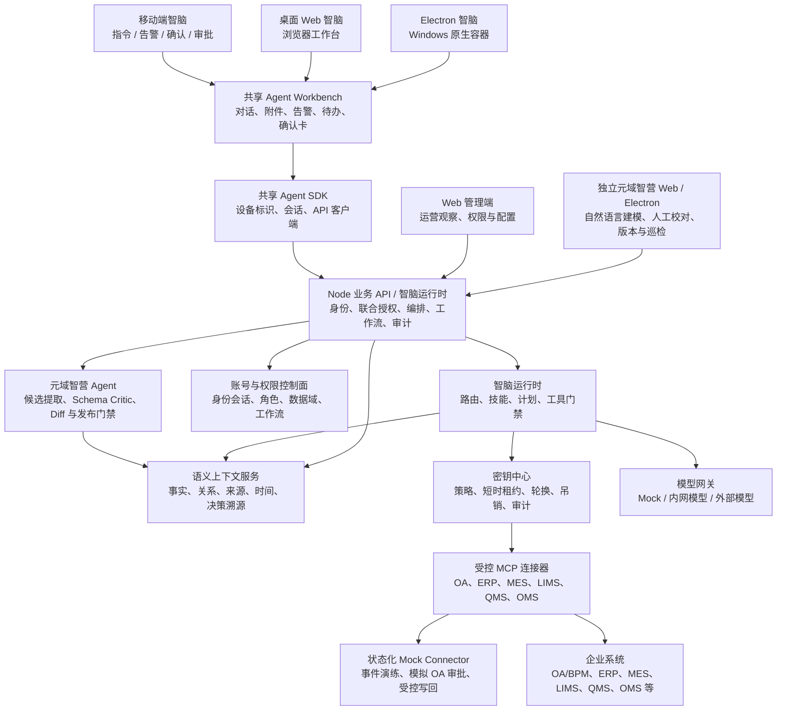
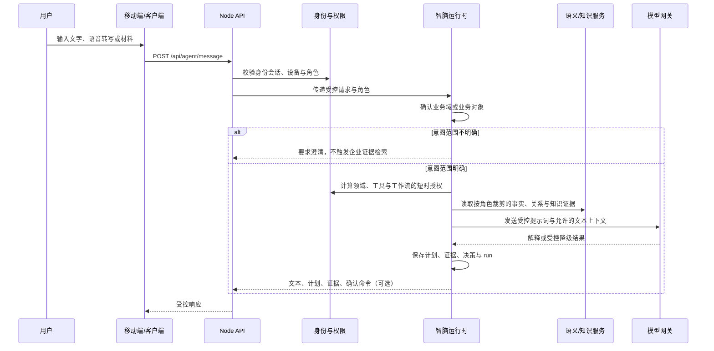
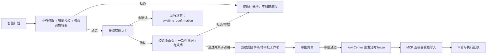
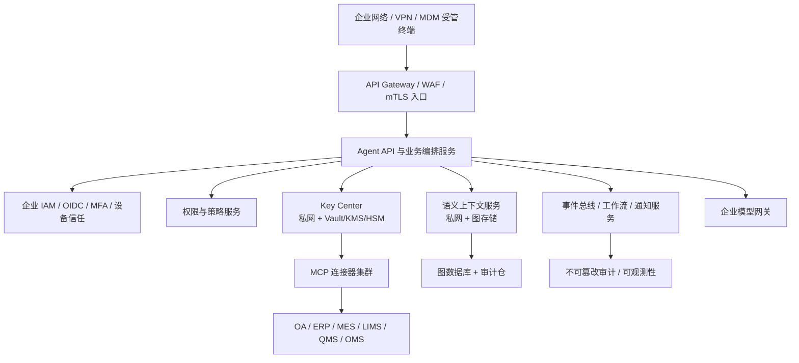

# 元域智脑：整体架构说明

> 文档版本：1.1；入口与目录更新：2026-09-03  
> 基线：当前代码库 `demo-platform`（Demo 实现）  
> 读者：产品、业务架构、研发、运维与安全团队

本文描述“元域智脑”企业 Agent 平台的职责边界、运行链路、接口与部署形态。默认演练数据来自供应链、生产和质量场景，不将产品限定为单一行业。它不是生产部署方案；文中标注为 **Demo** 的实现需要在上线前替换或加固。跨版本完成度以 [当前状态](../overview/PROJECT_STATUS.md) 为导航，生产要求见 [生产架构与运行说明](../operations/PRODUCTION_ARCHITECTURE_AND_OPERATIONS.md)。

多人协同开发采用模块化单体的目标边界。模块需求、API、技术架构、数据所有权和 Codex 上下文以 [模块文档中心](../modules/README.md) 为准；全局设计见 [多人协同架构方案](../modules/COLLABORATION_ARCHITECTURE.md)，API 路由归属见 [API 目录](../modules/API_CATALOG.md)。

## 1. 架构目标与设计原则

2026-09-08 身份层增量：各端经统一身份源适配器验证外部身份，再映射到平台 IAM；会话服务不再包含钉钉专属逻辑。身份源可为钉钉或多个企业 OIDC，业务授权及数据范围不由外部角色声明决定。配置、扩展契约与限制见 [身份源适配指南](../guides/IDENTITY_PROVIDER_ADAPTERS.md)。

平台面向企业业务协作与日常工作场景，提供由移动端、桌面 Web 与 Electron 承载的受控 AI 能力层，以及独立的元域智营 Agent。

核心目标如下：

1. 将员工请求、风险告警、审批和业务回执收敛到统一多端智脑工作台。
2. 将企业数据、模型、连接器和高风险工作流置于服务端控制平面，客户端不持有高权限凭据。
3. 将“人员、原材料、产品、设备、门店”作为跨域业务与语义上下文的统一锚点。
4. 让智脑只根据可访问的证据生成计划；写入动作必须经过确认、审批、审计和受控连接器。
5. 分离员工智脑、元域智营 Agent 与管理控制面：分别负责业务/日常任务、语义模型建设、运行观察与权限配置。

平台采用以下原则：

- **默认拒绝**：智脑是独立服务主体，不天然拥有业务系统权限。
- **联合授权**：有效权限为 `用户身份权限 ∩ 智脑服务主体权限 ∩ 设备会话策略 ∩ 数据域与工作流策略`。
- **先证据、后结论**：知识库和语义图的结果必须带来源、分级与可追溯信息。
- **先计划、后写入**：高风险动作必须经历“计划 → 用户确认 → 审批 → 执行 → 回执”。
- **密钥不出控制面**：业务服务、浏览器、移动端和模型都只获取受控能力或不透明租约句柄，不获取真实密钥材料。
- **任务上下文隔离**：每个任务具有独立的服务端会话、消息、确认动作与上下文预算；达到 70% 自动压缩。
- **权限变更即失效**：会话上下文记录角色和组织数据域指纹，权限发生变化时旧答复不再展示或进入后续推理。

多任务、上下文压缩、Codex 能力差距与安全复审详见 [ZHINAO_AGENT_ARCHITECTURE_V2.md](ZHINAO_AGENT_ARCHITECTURE_V2.md)。

### 1.1 系统接入的三层目标模型（2026-09-25）

元域智营端的语义建设按三层组织，**接入是最底层前提**：语义建模的一切输入都必须可追溯到某个已接入系统。

| 层 | 实体 | 生命周期 | 归属 | 说明 |
| --- | --- | --- | --- | --- |
| 接入层 | `SystemConnection`（每系统一条） | **长期资产**：草稿 → 已登记 → 已授权 → 已连通 →（已停用 ⇄ 已连通） | 元域智营端 | 系统「类型」属平台级、全租户共享；接入「实例」属租户资产，按租户隔离 |
| 建模层 | `ModelingSession`（一次建模尝试） | **一次性**：选系统（N≥1）+ 材料 + 诉求 → 提案 → 复核 → 采纳/驳回 | 元域智营端 Agent 工作台 | 选系统为必选前提，空选择不允许提交 |
| 治理层 | `SemanticModel` / `Version` / `Snapshot` | **长期资产**：草稿 → 校验 → 确认 → 发布 → 回滚 | 元域智营端 | 沿用既有治理链路（Schema Critic → Diff → 复核 → 确认令牌 → 发布 → 快照） |

统一事实源为 `backend/src/data/system-catalog.js`（系统目录）与 `backend/src/services/system-registry-service.js`（租户级接入实例）。此前系统清单分散在 5 处且互不一致，已收敛；决策理由与退出条件见 [ADR-009](adr/ADR-009-system-registry-single-source.md)，实施进度见 [系统接入重构方案](SYSTEM_ONBOARDING_RESTRUCTURE_PLAN.md)。

**接入层已落地为独立领域（2026-09-25）**：`backend/src/domains/system-onboarding/`（契约面 4 项导出）+ `backend/src/services/system-access-service.js`（面向运营视图的组装与**真实连通性探测**）。职责分界是「注册表是事实源，接入服务只做组装与探测」——后者不新增任何系统定义、不复制任何清单，连接器信息一律读注册表 `definition.connector`。主视角在**元域智营端**（`apps/semantic-operations-console/src/components/SystemAccessWorkspace.vue`），管理 Web 已不再有接入入口。决策理由、放弃项与退出条件见 [ADR-011](adr/ADR-011-system-onboarding-domain-extraction.md)。

**建模层的「选系统」已落为范围契约（2026-09-25）**：`build_model` 与 `discover_sources` 两类意图必须携带 `systemCodes`，空选择一律 400，**没有「推断为空就回落到全部可访问连接器」**。范围只有两个显式入口（请求体的 `systemCodes`，或调用方显式声明 `includeAllRegistered`），返回的 `selectionSource` 如实标注范围怎么来的；文本里出现的系统名降级为「提到但未选择」的提示素材。越权选择**阻断而非裁剪**（403）。覆盖结果以 `task.systemScope` 如实上报。决策理由与 4 条复审条件见 [ADR-012](adr/ADR-012-explicit-modeling-scope.md)。

**跨系统标识对应是「上报 + 人工确认后并入」，不是自动写入（2026-09-25）**：`semantic-identity-link-service.js` 把所选系统的声明收拢成字段目录，做三档标识识别（主键 / 业务键 / **未识别**），再按事务概念别名表推导跨系统标识对应，并显式上报四类分歧（标识归属歧义、同义不同名、键形状不可对齐、同名声明不一致）。**对象自己的标识必须指向该对象自身概念**——概念不同的标识字段是引用而不是自身标识，否则外键会被当成主键。推导结果落在 `proposal.identityLinking`，**不自动并入** `relationshipTypes`；并入只发生在人工逐条确认之后（`identityLinkConfirmations`，走既有复核动作），且并入的边标 `provenanceType: 'inferred'` + `derivedFrom`，与材料证据（`declared`）在草稿里可区分。整套推导**不依赖模型**，因此可在 mock 下复现（`test:identity`）。见 [ADR-014](adr/ADR-014-identity-linking-as-assumption.md) 与 [ADR-015](adr/ADR-015-identity-link-confirmation.md)。

**确认要问清「三态各一种输入」，且「不可按值连接」必须在草稿里机器可读（2026-09-25，阶段 4d）**：链接定级从二态改**三态**——`linkable` / `requires_mapping` / `shape_unknown`，第三态是刻意拆出来的（`linkStatusOf(field.shape, expectedShapeOf(target.identifierKind))` 原先是二元比较，而 `field.shape` 有三个取值 `agent` / `business` / `null`，于是**「形状判不出来」的裸名被当成了「形状已知且不同」**，实测 7 条 `requires_mapping` 里 2 条如此）。`requires_mapping` 的确认必须附**结构化映射定义** `keyMapping`（`fromField` / `toField` 须与链接**逐字一致**、`basis` 四类枚举、`master_data_lookup` 必填 `lookupSource`、`owner`、`version`），自由文本不再被接受；`shape_unknown` 必须先做形状判定（`agent` / `business`），判定后**重新定级**，**且不写回字段声明**（`shape` 是**这条边上的结论**，写回会污染 `buildSystemFieldCatalog`）。映射定义**进草稿**（关系上的 `keyMapping`，已登记进 `sanitizeProposalDraft` 关系白名单），但**证据等级不变**（仍 `inferred`）。**不做独立映射表实体**：实测 7 条映射无一条被两条边共享。见 [ADR-019](adr/ADR-019-structured-key-mapping.md)。

**而一条对应「有没有资格被确认」本身也要判，且判据只有一个（2026-09-25，阶段 4e）**：确认这一关的前置条件是**两端 `objectId` 都在本次候选对象内**——这正是草案校验（`sanitizeProposalDraft` 要求关系两端引用候选对象）的判据，因此它由推导层从**同一个 `objects` 数组**构造为 `link.eligible`，`说得出可确认` 与 `写得进草稿` 不可能分叉。不可确认的对应**仍然列在清单里**（它是系统声明里真实存在的跨系统引用，隐藏它等于宣称「本次没有这条引用」），但带 `ineligibleEndpoints` 与**可行动**的 `ineligibleReason`（点名对象 + 依据来自哪里 + 先让它成为候选对象），且**没有确认入口**；确认请求给专用错误码 `SEMANTIC_IDENTITY_CONFIRMATION_ENDPOINT_OUT_OF_SCOPE`，检查次序 **链接存在 → 资格 → 形状 → 映射**（先问一条写不进草稿的边「形状是什么」没有意义）。**两个判据必须分开**：链接上的 `declarationSourced` 只回答「依据来自系统配置声明还是本次候选对象」——旧口径把它当资格用，实测让 `ERP.Inventory.lot_no`（**可确认**，因对象名与候选对象 `Inventory` 同名）被宣称「来源系统未进入候选对象」，是一句界面事实错误。`summary` 给出 `eligible` / `ineligible` 两项独立计数。**不放宽草案校验**（会产出悬空边），也不自动把声明里的对象补进候选（那会让标识推导反向决定对象抽取，属 ADR-012 / ADR-013 / ADR-017）。见 [ADR-020](adr/ADR-020-identity-link-confirmation-eligibility.md)。

**而支撑这些对应的等价假设必须先被裁定（2026-09-25）**：`alias_divergence`（同一概念由多个字段名表达）不是一条普通的冲突——它是跨系统对应的**前提**。实测 11 条对应里有 9 条站在「同一概念下的多个字段名指向同一实体」这个没人回答过的假设上（`MaterialBatch` 一个概念下的三个字段名就支撑了 4 条），而界面此前只有「确认这条对应」，没有「这个前提成不成立」。裁定入口落在同一处（`identityConflictRulings`），两类动作 `same_entity` / `distinct_entity`（后者必须给出字段名的**等价类划分**，且是严格划分）。**裁定不并入草稿、不产生证据等级**——它改变的是链接推导的**输入**（哪些对应成立），采纳仍必须走确认；因此裁定与 `inferred` 不在同一层，不可能混用，顺序也是「先裁定假设、再采纳结论」。裁定为不同实体时，跨等价类的对应被**撤下**（`withdrawnLinks`）而不是保留为可疑项。见 [ADR-016](adr/ADR-016-identity-conflict-rulings.md)。

**而同一对象的同名声明也必须裁定「合并 / 区分粒度」（2026-09-25）**：同一系统内同一 `objectId` 的多处声明（受控词汇表、已配置映射、材料抽取）字段集不一致时，目录**默认取字段并集**——这个默认动作此前不可见，而并集还会参与标识识别，于是产出一个**没有任何一处声明过的复合体**（实测 `MES.ProductionBatch` 被并集授予 `production_batch_id`，而它的配置映射只声明 `batch_no`）。裁定入口同样落在既有复核动作（`declarationRulings`），但键是**分歧项**而非概念（`object:Inventory` / `source:ProductionBatch@mes.production_batch`），与 ADR-016 的概念级裁定是两套粒度。动作 `merge`（并集显式化）/ `distinct`（**不并集**：按声明严格划分成组，各组按自己声明的字段识别标识）。裁定同样**不写草稿、不产生证据等级**——它改的是字段目录的组成。**未裁定也必须披露并集**：条目带 `declarations` / `exclusiveFields` / `declarationState`，`identifierBasis` 写明「这是在并集上识别的」；拆分、被排除的声明、因改名而消失的对应全部显式列出。见 [ADR-018](adr/ADR-018-declaration-divergence-merging.md)。

**范围随后从「上报口径」变为「过滤器」（2026-09-25）**：阶段 4 要按选中系统的字段目录抽取对象，抽取本身就是一次筛选，因此 ADR-012 的退出条件 2 被触发，范围确定为**过滤器**——来源**全部**在所选范围外的对象与随端点悬空的关系**不进提案**，但必须以 `excludedObjects` / `excludedRelationships` **可读地列出**并提示补选系统（「过滤」不等于「静默丢弃」）。来源**部分**超出范围的对象**保留**并记入 `partialScopeObjects`（它有合法在范围内的来源，排除会丢掉范围内系统的真实事实）；来源为 `UNASSIGNED` 的**一律保留**（把「未标注」当「超范围」会让纯自然语言抽取路径整体被清空）。字段 `outOfScopeObjects` 被拆为 `partialScopeObjects` 与 `excludedObjects` 后移除——保留并集别名会让调用方无法从字段名判断对象是否还在提案里。越权阻断**先于**范围过滤，过滤不得成为对越权系统的静默裁剪通道。见 [ADR-013](adr/ADR-013-scope-as-filter-with-explicit-exclusions.md)。

**材料归属由模型取证、服务端判定，且确认前只是候选（2026-09-25）**：这是「唯一真正需要模型能力」的那一段。此前模型虽已接入抽取（`discoverNaturalSchema` → `validateNaturalSchema`），但契约里没有「这张表属于哪一处」，于是抽取出的对象一律 `UNASSIGNED`——既进不了字段目录（跨系统对应**恒为 0 条**），又让 Critic 的「受控来源系统」失败、草稿无法采纳；而卡住链路的信息（材料里逐字写着的「ERP 采购订单表 purchase_order」）一直就在材料里。现在：模型只提供**逐字归属原文**（契约里**没有**系统码字段），系统码由服务端用注册表判定，且只用系统码与系统名、**不认业务词别名**；判定结果一律是**候选**，不写 `sourceSystems`、**不参与范围裁剪**，但**可以**进字段目录（否则跨系统连接在非结构化材料上永远建不起来）。候选转事实要走人工确认（`sourceAssignments`，依据不得为空），确认后才写入来源系统并**这时才**按范围重新裁剪。四道关口顺序固定——**归属确认 → 等价裁定 → 同名声明裁定 → 对应确认**（每一关改的都是下一关的输入：归属决定字段目录、等价裁定决定哪些对应存在、声明裁定决定目录的组成、对应确认才是写草稿；而对应确认内部还要先过**资格**，只有两端对象都在候选内的对应才写得进草稿，见 [ADR-020](adr/ADR-020-identity-link-confirmation-eligibility.md)）。见 [ADR-017](adr/ADR-017-model-extraction-attribution.md)。

**候选对象的来源与「没被生成」的原因必须可读（2026-09-26，阶段 4f）**：候选对象这条路此前是**沉默**的——实测材料写「采购订单、发运单、出库单、客户投诉」时只得到 **1 类**候选（`PurchaseOrder`），另外三个**静默消失**，界面上没有一句话解释它们去哪了；而「候选从哪来」也有两条静默路径（自然语言抽取在**模拟运行时**与**材料无字典线索**时都只 `return null`，两者要做的补救却完全不同）。现在：受控目录命中披露**命中词**（`matchedTerms`）与**覆盖率**（命中 M / 共 12 类），并说明它是**词面匹配的兜底**而不是抽取结果（「材料里写到、但目录未覆盖的业务对象**不会**出现在候选里」）；抽取跳过给出**可区分的原因码**（`mock_runtime` / `not_dictionary_like`，各自一句中文说明）；披露落在既有 `reviewNotes`，**不新增实体、不改 schema、不放进 `objectTypes`**；**不放宽任何门槛**（候选为空仍是硬错误）。**边界如实**：披露是**覆盖率级**而非**清单级**——能提示「可能漏」，**不能**点名「漏了哪个」（那需要对象抽取能力，正是阶段 4 剩下的一半）；`not_dictionary_like` 在模拟环境下不可达，只能靠纯函数层用例覆盖。见 [ADR-021](adr/ADR-021-candidate-provenance-disclosure.md)。

**「连通性测试」是真的**：探测会监听本地临时端口、发分页 HTTP 请求、校验 `mock-onboarding-query.v1` 契约与分页完整性，并返回 `requests / pageCount / recordCount / readableRecords / objectTypes`。**但它读的是内置合成 HTTP 数据源（`sourceKind: 'local_mock_http'`），不是任何真实企业连接器**——返回值与界面都必须标注这一点，不得表述为生产验收。

**多租户贯穿约定**：系统类型、角色可见性策略、模板目录等属平台级共享资产（无 `tenantId`）；接入实例、建模会话、模型草稿/快照等属租户资产，状态读写一律经 `semanticTenantStateKey()` 落到当前租户工作区，租户标识只取受信身份上下文，不接受请求体传入。**已知不洁**：接入配置样例（责任人 / 同步频率 / 字段→对象映射）仍来自 demo 种子、尚未租户隔离，以 `configurationSource: 'demo_seed'` 显式标注。

## 2. 全局逻辑架构



### 2.1 控制面与业务数据面

| 层级 | 组件 | 主要责任 | 明确不负责 |
| --- | --- | --- | --- |
| 客户端 | 移动端、Web、桌面端、共享 SDK | 展示、受控输入、设备标识、会话携带、确认交互 | 保存 KMS/系统/模型密钥；直接写企业系统 |
| 身份与策略控制面 | 账号中心、身份会话、权限中心、智脑授权 | 身份、角色、设备匹配、数据域与工作流授权 | 保存企业业务事实、发放真实密钥 |
| Agent 控制面 | 智脑编排、技能、工具注册、业务门禁、工作流、运行记录 | 路由、受控检索、计划、确认卡、审批工作项、审计 | 绕过审批或将模型输出直接当作写入指令 |
| 语义证据层 | Node 语义投影、Python Semantica 服务 | 已授权事实图、关系、来源、时间、冲突与决策溯源 | 用户认证、授权决策、密钥保存、业务写入 |
| 凭据控制面 | Key Center、KMS/HSM/Vault 适配器 | 连接器策略、短时 lease、轮换、吊销与审计；可单独启动 Key Center HTTP 控制面 | 返回真实密钥给终端或模型 |
| 集成与数据层 | MCP 连接器、OA/ERP/MES/LIMS/QMS/OMS | 按策略读写企业系统 | 被客户端直连；无租约的高风险写入 |
| 演练数据层 | 状态化 Mock Connector、场景运行时、模拟 OA 审批 | 在不连接生产系统的前提下生成事件、审批与可回放流程 | 保存真实凭据、调用真实企业系统、替代生产事实数据 |

## 3. 工程结构与模块映射

```text
demo-platform/
├─ frontend/                    PC Web 管理端（Vue + Vite）
├─ backend/                     Node.js 原生 HTTP API 与智脑 Demo 运行时
├─ apps/
│  ├─ mobile/                   移动端 Vue 智脑应用，可封装为 Tauri
│  ├─ desktop/                  桌面 Web + Electron 智脑应用
│  └─ semantic-operations-console/ 独立元域智营 Web + Electron（系统接入 / Agent 建模 / 模型校对与版本）
├─ packages/agent-sdk/          多端共享 API 客户端、会话与设备标识逻辑
├─ packages/agent-ui/           双端共用前端资产：元模型/本体面板、知识资料面板、异常助手面板、设计基线样式
├─ packages/agent-workbench/    多端共享智脑交互、状态和 Codex 风格视觉组件
├─ packages/semantic-operations-sdk/ 元域智营共享协议与认证客户端
├─ services/semantic-context/   独立 Python Semantica 适配服务
├─ docs/                        唯一文档中心：概览、架构、模块、开发、运维、指南与交付资料
└─ deploy/                      部署环境变量示例
```

后端 `backend/src/` 的分层：`routes/`（HTTP 编排）→ `domains/*/public-api.js`（领域契约面）→ `services/`（应用服务）、
`repositories/`（持久化端口实现）、`infrastructure/domain-events/`（事件出箱与 Broker，
**2026-09-26 由 `domains/events` 迁出**，见 [MODULARIZATION_AUDIT](MODULARIZATION_AUDIT.md) 第 4 节）。
`domains/` 下**每一个**目录都必须是带 `public-api.js` 的业务边界（`INFRASTRUCTURE_DOMAINS` 已收敛为空集）。

### 3.1 前端与终端

| 模块 | 主要入口 | 职责 |
| --- | --- | --- |
| `frontend` | `frontend/src/App.vue` | PC Web 治理端：总览、风险、世界模型、私有 Agent 运营、通知、配置治理和独立权限管理。权限页支持组织树、人员多角色、页面/按钮 RBAC、数据范围和审计；有效按钮权限还驱动风险/采购、Agent 评测、模型配置、模拟中心、Key Center、OA 元模型和世界模型草稿等操作入口。Web 对授权拒绝 fail-closed，执行 30 秒可见态权限轮询，并使用权限代际阻止延迟响应回填旧数据。通过 `frontend/src/api/client.js` 调用 API。 |
| `apps/mobile` | `apps/mobile/src/App.vue` | 移动端智脑宿主：使用共享 Workbench，提供 OA/平台账号登录、告警、聊天、语音、受限图片/PDF 输入、确认卡、回执和待办。 |
| `apps/desktop` | `apps/desktop/src/App.vue`、`apps/desktop/electron/*` | 桌面 Web 与 Electron 智脑宿主：与移动端功能等价；Electron 使用隔离 preload、关闭 Node 集成和 webview、限制导航/外链/权限/下载，并提供最小窗口控制 IPC。 |
| `packages/agent-sdk` | `packages/agent-sdk/src/index.js` | 创建稳定设备 ID，维护身份会话，统一注入客户端/设备头，封装移动端与桌面端所需 API。 |
| `packages/agent-ui` | `packages/agent-ui/src/index.js` | 双端共用前端资产的唯一包：`src/meta-model/`（元模型与本体面板）、`src/knowledge/`（知识资料与记忆校对面板）、`src/agent/`（异常助手面板）、`src/system-access/`（接入侧的元模型连接模板/草稿治理）、`src/styles/`（企业设计基线 `main.css` 与元模型样式）。依赖经 `package.json` 的具名 `exports` 声明，**不用相对路径穿透兄弟包的私有源码**（见 [ADR-010](adr/ADR-010-agent-ui-package-extraction.md)）。 |
| `packages/agent-workbench` | `packages/agent-workbench/src/AgentWorkbench.vue` | 统一三端的身份登录、对话、语音、材料上传、告警转分析、确认执行、待办和中性深色视觉系统，避免终端功能漂移。 |

移动端和桌面端均使用 Vue 3 + Vite。移动端保留 Tauri 2 封装配置；桌面端以浏览器 Web 为渲染基线，并以 Electron 作为主桌面容器，浏览器和 Electron 共用同一个构建产物。旧 `src-tauri/` 仅保留为兼容实验配置，不是当前桌面发布链路。

### 3.2 Node API 与智脑运行时

后端入口为 `backend/src/app.js`。它使用 Node 原生 `http` 模块提供 API；通用 JSON 响应/正文读取、公开路径与页面读取策略位于 `backend/src/http/`，身份、模拟运行和权限管理路由已拆入 `backend/src/routes/`。主入口负责 CORS、请求体大小限制、按来源 IP 的限流、请求 ID、身份解析、统一页面门禁和领域路由编排。

| 子域 | 关键文件 | 当前职责 |
| --- | --- | --- |
| 身份与会话 | `account-center-service.js`、`oa-auth-service.js`、`identity-session-service.js` | 平台账号/OA Demo 登录，签发8小时身份会话并写入统一 Repository，校验会话角色、策略版本与设备 ID。 |
| 权限与业务门禁 | `iam-store.js`、`access-control-service.js`、`permission-management-service.js`、`authorization-service.js`、`permission-center-service.js`、`zhinao-authorization-service.js`、`business-control-service.js` | Repository 化 IAM 组织/人员/多角色，页面读取和按钮写入 RBAC，五类组织数据范围，版本化保存与审计；为关键写操作选择实际授予目标按钮的有效角色，同时执行风险查询组织过滤、智脑授权、工具/工作流交集和业务条线检查。 |
| 核心元对象 | `core-meta-object-service.js` | 定义人员、原材料、产品、设备、门店，定义各类业务流程的必需对象、权威状态和组织归属检查。 |
| Agent 编排与评测 | `private-agent-service.js`、`agent-orchestration-service.js`、`agent-skill-registry.js`、`agent-evaluation-service.js` | 根据意图路由生产、市场、内务专业能力，生成受控计划、证据和确认命令；管理角色可运行确定性的控制评测。 |
| 工具与连接器 | `agent-tool-registry.js`、`mcp-connector-service.js`、`procurement-service.js` | 服务端注册工具的 `id/scope/domain/inputSchema`，拒绝未知工具与 Schema 外参数；执行只读分析或需要工作流授权的写入草稿操作，并为需要凭据的工具申请 lease。 |
| 工作流与审计 | `agent-workflow-service.js`、`agent-runtime-store.js`、`agent-operations-service.js` | 创建待审批草稿；安全输入只保留审计 run，自动可复用 memory 默认关闭；只有同一有效角色同时具备 Agent prompt/execute 权限并通过数据域、工作流和业务校验时才生成命令。run、运行统计与工作项按当前有效角色集合和 `tenant + subject` 交集查询，次角色撤销后立即退出可见集；Agent execute 还绑定原 run 角色、`session + device`、原命令和一次性凭据。 |
| 上下文与知识 | `semantic-context-service.js`、`enterprise-knowledge-service.js`、`world-model-template-service.js` | 提供按角色过滤的事实、关系、决策证据、企业知识和世界模型配置草稿。 |
| 模型、提示词安全与多模态 | `local-model-gateway.js`、`prompt-security-service.js`、`multimodal-input-service.js` | 选择 Mock/内网/外部模型；标准化并扫描直接/间接注入，隔离风险上下文，校验模型输出和附件签名，并在连续失败时熔断降级。 |
| 密钥控制 | `key-center/key-center-service.js`、`key-center/kms-adapter.js`、`services/key-center/app.js` | 在进程内模拟租约签发、轮换、吊销与审计；提供独立控制面 `/v1` 契约，供后续工作负载身份调用。 |
| 状态化流程模拟 | `mock-scenario-service.js`、`system-integration-service.js` | 通过 Mock Connector 将基础种子数据与运行时事件合并；演练场景会生成模拟 OA 审批、受控模拟写回、Connector 故障注入、健康状态告警与审计回放。 |

### 3.3 前端组件的三层归位判据（2026-09-26）

此前「什么进 `components/`、什么留在 `features/`」没有可复用判据：7 个 feature 目录只含 1 个文件，
`components/` 只有 3 个文件——当 1 个文件的 feature 与 7 个文件的 feature 平级时，目录结构不再传达信息量。
现已明确三层，**归位按「是否取数据」与「是否跨端」判定，不按文件数**：

| 层 | 位置 | 判据 | 反例（不属于本层） |
| --- | --- | --- | --- |
| 展示组件 | `<端>/src/components/` | **无业务语义**：只受 props、不发请求、不读全局状态 | 组件内部自己 `fetch` 或读 pinia/reactive 全局 → 属下一个 |
| 跨端共享业务组件 | `packages/agent-ui/src/<domain>/` | **跨端共享**：被两个及以上端引用，且依赖经 `package.json` 的具名 `exports` 声明 | 用相对路径穿透兄弟应用的 `src/`（见 [ADR-010](adr/ADR-010-agent-ui-package-extraction.md)，棘轮基线 0） |
| 单端页面级组件 | `<端>/src/features/<domain>/` | **单端专用**：只有本端路由/页面引用，含取数与业务流程 | 被第二个端引用 → 上提到 `packages/agent-ui` |

判据与 [MODULARIZATION_AUDIT](MODULARIZATION_AUDIT.md) 第 6 节一致；审计第 9 节执行顺序第 5 项由此关闭。

## 4. 核心对象与元模型架构

### 4.1 五个核心元对象

| 对象 | 权威来源 | 典型业务作用 |
| --- | --- | --- |
| 人员（Person） | OA / 账号中心 | 责任人、组织、角色、技能、审批身份与操作审计。 |
| 原材料（RawMaterial） | ERP / SRM / LIMS / WMS | 采购、库存、批次、COA、检验和供应商质量。 |
| 产品（Product） | PLM / MES / LIMS / ERP / QMS / OMS | 配方、生产批次、放行、销售、投诉与召回。 |
| 设备（Equipment） | MES / EAM / IoT | 工艺、产能、维护、校准、异常与对产品的影响。 |
| 门店（Store） | MDM / OMS / POS / ERP | 门店组织、区域、营业状态、库存、订单、履约、客诉与店内设备。 |

业务流程必须至少关联一名人员，并关联与目标直接相关的业务对象。例如采购需要 `Person + RawMaterial`，生产需要 `Person + RawMaterial + Product + Equipment`，门店运营需要 `Person + Store`，门店补货需要 `Person + Store + Product`；缺失对象时只允许保存草稿，不能让智脑发起执行、提交审批或写入企业系统。门店绑定同时返回权威 `organizationId`，生产授权必须再与当前主体组织数据范围求交集。

### 4.2 元模型治理

平台包含 OA 元模型和世界模型模板两类治理能力：

- OA 元模型覆盖组织、人员、岗位、业务角色、审批流、审批节点、待办、业务动作与审计。
- PC 端允许业务建模协作人编辑对象、字段和关系草稿、执行校验和模拟构建；只有管理层能发布。
- 世界模型模板定义对象、字段、关系、来源系统与数据分级的映射草稿，并按“创建 → 校验 → 发布”流转。
- 核心对象是语义图的一层锚点，进入图谱的已授权事实应关联对象、来源系统、来源记录、生效时间、记录时间和数据分级。

## 5. 请求、授权与执行链路

### 5.1 普通 Agent 请求



`private-agent-service.js` 的关键步骤为：

1. 对文字执行 Unicode 标准化、零宽/控制字符、拆字、错拼和编码载荷检查；附件仅校验数量、大小、MIME、文件魔数、文件名和可打印字节片段，内容级状态仍为 `unscanned`。
2. 用确定性规则路由至生产、市场、内务一个或多个专业能力；无明确业务域或业务对象时返回澄清提示，不进入知识、语义事实和 Connector 检索。
3. 计算智脑的授权数据域、允许只读工具和允许工作流工具；无授权时默认拒绝。
4. 检索按角色裁剪的企业知识、语义事实和系统证据，并逐条执行间接提示词注入检查；风险证据进入隔离区，本次任务降级为只读。
5. 对采购或可产生工作流的意图，执行业务条线、智脑工作流和核心元对象的联合检查。
6. 生成模型摘要或在模型不可用时降级为基于既有证据的确定性计划；OpenAI、DeepSeek、compatible 和 local 模型必须直接返回无未知字段的严格 `agent-summary.v1` JSON，Mock 由服务端封装。服务端再对结构、泄密、脚本和执行声明二次校验；没有服务端 execution receipt 的“已执行”声明一律被确定性文本替换。
7. 安全输入只保留审计 run，自动可复用 memory 默认关闭；早期拒绝只记录租户、主体指纹、风险信号和内容指纹，不保存输入原文。
8. Agent run 的创建与查询按 `tenant + subject` 隔离；可写命令额外绑定原 `session + device`、原命令、一次性确认凭据和有效期后返回客户端。
9. 工具调用先经过服务端注册与输入 Schema 校验。当前工具的业务对象和组织参数由原 run 的权威上下文生成，不接受客户端附加字段；校验失败不会进入授权、Key lease 或业务服务。

### 5.2 高风险写入工作流



写入动作并不由模型直接执行。在创建待确认 run 之前，服务端会选择一个同时持有 `agent.prompt.run` 与 `agent.command.execute` 的有效角色，并以同一个角色重新计算智脑数据域授权、工作流角色资格和业务动作/核心对象校验。任一条件失败时都不会生成待确认动作：响应为 `command: null`，不签发 confirmation Token，只保留只读建议与拒绝原因。

生成命令后，`executeTool` 在执行前继续校验：

1. run 是否属于当前 `tenant + subject + session + device`，原 run 授权角色是否仍为人员的有效角色且仍持有执行按钮，并处于 `awaiting_confirmation`；
2. 客户端动作是否与原 run 保存的 `proposedCommand` 完全一致；
3. 一次性确认凭据是否正确且未过期、未使用；
4. 当前授权是否仍包含所需工作流工具；
5. 业务动作是否仍通过角色能力、智脑授权和核心对象校验；
6. 如需访问 ERP 等连接器，是否可由 Key Center 为当前任务签发对应的短时凭据租约；
7. 工具执行后是否创建受控草稿、待审批工作项和运行记录；执行状态禁止重复消费。

当前 Demo 已定义采购需求、采购发起、采购审批、质量调查、市场投诉处置与预算核验等受控流程。工作项通过 Repository 写入 SQLite，状态以 `awaiting_approval` 为主，用于演示审批路由、可见性和跨重启恢复。

## 6. 认证、权限与数据边界

### 6.1 当前身份链路

客户端经 `Agent SDK` 发送以下上下文：设备 ID、平台、版本、设备会话，以及统一身份会话、企业 Bearer 或（仅 Demo）角色头三者之一。后端优先校验 `x-identity-session` / `x-oa-session`；否则使用企业 JWKS 校验 Bearer 的 issuer、audience、tenant、算法与时效并映射 IAM 人员；最后才允许非生产 Demo Header。账号状态、角色集合或角色策略变化后，权限会在下一次请求实时收敛。管理 Web 与智脑三端通过异步 Token Provider 按请求取令牌，不写入浏览器持久化存储。

Agent 运行时不把“角色相同”视为“用户相同”。run 创建与 `/agent/runs` 查询按 `tenant + subject` 裁剪；多角色查询只聚合当前仍有效角色的 run，operations 使用同一集合统计，工作项还要求创建角色或审批角色可见。次角色撤销后对应 run、统计和工作项立即退出可见集。对待确认命令，还必须使用创建时的 `session + device` 与一次性凭据；memory 仍按主角色与主体隔离，不随历史查询范围扩大。

身份来源包括：

- 平台账号：演示账号表 + 统一演示密码。
- OA/BPM：当前为 Mock 登录，签发统一身份会话。
- 企业 OIDC：资源服务端验证和三端令牌通道已完成；授权码 + PKCE、MFA/step-up、续期与全局注销需按企业 IdP SDK 联调。
- 后续身份源：LDAP/AD、企业微信/钉钉经身份代理统一转换为可信 OIDC 主体。

显式但未知的主体不会回退为任一业务角色，而是得到空角色与空权限并 fail-closed。角色基线 fallback 只在非生产环境且身份来源由服务端请求解析器标记为可信 `demo_header` 时启用；任意主体字符串或普通身份会话不能伪造这一来源。

### 6.2 授权模型

| 控制维度 | 当前实现 | 作用 |
| --- | --- | --- |
| 用户角色 | `authorization-service.js`、`permission-center-service.js` | 决定页面、风险、数据域与业务能力基线。 |
| 智脑服务主体 | `zhinao-authorization-service.js` | 智脑主体默认拒绝，仅为本次请求给出可用领域与工具集合。 |
| 设备会话 | `device-session-service.js`、`identity-session-service.js` | 记录客户端设备；身份会话可绑定设备 ID。 |
| 数据域 | production / marketing / internal | 裁剪世界模型、连接器、工具与语义事实。 |
| 工作流与业务动作 | `business-control-service.js`、`agent-workflow-service.js` | 校验角色能力、确认、审批人和工作流工具。 |
| 核心对象绑定 | `core-meta-object-service.js` | 校验流程所需的人员、原材料、产品、设备、门店是否齐备、状态可用且来自权威投影。 |

### 6.3 IAM 权限中心

PC Web 已将权限管理从“配置与治理”摘要中拆成独立页面。页面使用后端权限工作区展示组织树、人员归属/多角色、角色页面与按钮矩阵、数据范围和审计记录。前端要求 `effectiveAccess.menuIds` 与 `pagePermissionIds` 同时满足才允许导航，并只为有效页面懒加载数据；权限撤销后会清空旧页面数据并回落到首个可访问页。`buttonPermissionIds` 已接入风险详情/确认/批准、采购发起/审批、权限审计、Agent 安全评测、模型连接配置、模拟场景/审批/故障/重置、Key 策略轮换/租约吊销、OA 元模型保存/校验/模拟/发布，以及世界模型草稿创建/校验/发布。前端仍只是交互控制：后端对纳入页面策略映射的 GET 资源再次校验页面读取权限，并对对应写 API 再次校验按钮权限；`GET /api/account-center` 必须先认证并具备 `page.config.view`，`GET /api/permission-management` 必须具备 `page.permissions.view`，`GET /api/risk-cases/{id}` 还必须具备 `risk.detail.view`。`permission.audit.view` 独立控制服务端审计数组和 Web 审计页签，管理页访问权不自动包含审计查看权。

人员可包含多个 `roleIds`。`access-control-service.js` 在每次请求中将有效角色的页面、按钮和组织 ID 取并集；关键写操作再从中选择实际授予目标按钮的具体角色交给下游业务门禁，不能只把 `primaryRoleId` 当作执行角色。Agent execute 还要求该角色与原 run 的授权角色一致，并保持原 `tenant + subject + session + device`、原命令和一次性 Token 绑定。`primaryRoleId` 仅用于兼容现有单角色 Demo 展示和旧契约。组织数据范围包含：

| 概念名 | JSON 值 | 边界 |
| --- | --- | --- |
| `SELF` | `self` | 强制锚定当前 IAM 人员直属组织，不能由客户端或策略组织 ID 覆盖；资源提供 owner 字段后还应收窄至本人。 |
| `CURRENT_ORG` | `current_org` | 强制锚定当前 IAM 人员直属组织，不能由客户端或策略组织 ID 覆盖；仅直属组织。 |
| `ORG_AND_DESCENDANTS` | `org_and_descendants` | 拒绝 `organizationIds` override；运行时始终锚定当前 IAM 人员直属组织并展开全部下级节点，忽略存储中的遗留/注入覆盖值。 |
| `SELECTED_ORGS` | `selected_orgs` | 仅策略明确选中的组织。 |
| `ALL` | `all` | 全部组织，用于受控管理角色。 |

基础风险查询先保留既有角色可见基线，再使用当前主体的有效组织 ID 过滤列表、详情和大盘中的基础风险集；状态化 Mock 告警仍按场景角色分发。风险详情路由额外校验 `risk.detail.view`，风险确认/批准、人员分配和策略保存在后端再次校验各自按钮权限，因此前端隐藏按钮不是唯一门禁。风险写操作完成后，服务端按同一主体重新读取 Repository 资源，重新执行角色基线、组织过滤和响应脱敏，不直接返回内部原始对象。

人员和角色策略保存必须提交 `expectedVersion`；版本不一致时拒绝覆盖。成功变更会保留操作主体、变更原因、前后值和时间，并使持有旧人员/角色/策略版本快照的身份会话失效。IAM 数据、审计和身份会话默认写入本地 SQLite，也可通过独立开关接入 PostgreSQL；生产仍需企业 IdP/主数据同步、tenant 与 RLS、不可篡改审计仓和集中式会话撤销。完整契约见 [IAM 权限中心说明](IAM_PERMISSION_CENTER.md)。

Web 的授权状态也作为异步数据代际：任意 `401` 或页面/按钮/业务权限类 `403` 都会发布授权失效事件，不重试原请求，清理受保护页面数据并 fail-closed 刷新有效权限；`AGENT_ORIGIN_ROLE_DENIED` 已明确加入该集合，原 run 角色撤销或失效会即时触发刷新。页面可见时每 30 秒轮询，隐藏时暂停、恢复可见时立即复核。页面加载、保存后重取与权限刷新等异步操作都校验权限代际、角色及页面/请求标识，延迟到达的旧响应不能回填到新权限上下文。

### 6.4 数据分类与多模态

移动端当前允许 JPEG、PNG、WEBP 与 PDF，每次最多 3 个附件，每个小于 4 MiB。服务端校验 data URL、MIME 与文件魔数一致性，并检查文件名和可打印字节片段中的注入信号。这只是签名/基础字节检查，内容级 scan 明确标记为 `unscanned`。

- 在接入可信的恶意文件扫描、OCR/PDF 沙箱、内容安全/DLP 和隔离审批前，本地或外部模型均不接收附件原文。
- `unscanned` 附件不能作为任何写操作的证据或参数来源。
- HTTP 请求体默认限制为 18 MiB，与 3 × 4 MiB 附件的 Base64 膨胀和 JSON 开销对齐；容量校验不代表内容已通过安全扫描。

## 7. 语义上下文与证据链

### 7.1 Node 侧 Demo 投影

`backend/src/services/semantic-context-service.js` 使用种子世界图和角色可见性规则提供：

- 角色过滤后的图节点与关系；
- 每条关系的来源提示；
- 风险、采购预检和 Agent 推荐的决策记录；
- 面向 Agent 的相关事实与关系片段；
- 面向 PC 治理界面的语义上下文概览。

这使得独立语义服务未启动时，前端和 Agent 流程仍可演示，但其本质是进程内、内存态的投影，不是生产图数据库。

### 7.2 Python Semantica 服务

`services/semantic-context/app.py` 是独立进程边界，默认监听 `127.0.0.1:3011`：

- `GET /health`：返回服务、时间和当前引擎状态；
- `GET /context/{role}`：返回指定角色的启动上下文契约；
- 若安装 `semantica`，优先使用 `semantica.context.ContextGraph` 记录启动决策；否则明确标识为 `projection-fallback`。

生产语义服务应在私网独立部署，接受经过权限服务裁剪的事实，通过 mTLS 和服务身份校验调用方，并将图、溯源和决策审计持久化。

### 7.3 Agent Evidence Trace

`agent-evidence-trace-service.js` 为每次智脑任务创建独立 Trace。正常分析、范围澄清、提示词拒绝、附件拒绝、授权拒绝、确认失败、执行成功和执行失败都具有明确终态；无权限或不可见 Run 的执行请求会创建不泄露原 Run ID 的独立拒绝 Trace。Run 通过 `evidenceTraceId` 关联 Trace，当前开发环境使用统一 Repository 的 SQLite 驱动跨重启保存。

Trace 依次记录输入/附件安全、意图路由、授权、企业知识/语义/接入系统查询、间接注入隔离、每个只读工具、模型调用或跳过、证据快照、计划、结构化决策、Run 持久化、确认尝试、业务复核、写入工具和回执。证据快照包含来源、业务主键、标题、摘要、密级、版本、采集时间、组织和内容哈希；敏感字段在持久化前剔除，不记录模型内部思维链。

每个事件覆盖前序哈希形成 SHA-256 链，Manifest 额外保护 Trace/Run/角色/租户/主体指纹/状态/事件数/头哈希和时间字段。读取时重新计算事件链和 Manifest，篡改会返回 `integrity.valid=false`。这属于开发环境的可检测篡改基线；生产必须迁移到只追加审计仓、KMS/HSM 签名、可信时间戳和 WORM 归档。完整契约见 [智脑执行证据追踪](AGENT_EVIDENCE_TRACE.md)。

## 8. 密钥中心与连接器

### 8.1 Key Center

当前 Key Center 以库模块方式运行在 Node API 进程中，生产设计预留独立的 `key-center` 微服务（建议内网端口 3010）。其策略模型按连接器和操作匹配，例如 ERP 创建采购草稿、OA 审批上下文、LIMS/MES/QMS/OMS 只读和模型网关。

租约的绑定信息包括：连接器、操作、用途、任务 ID、角色、智脑服务主体、签发时间与到期时间。返回给调用方的是不透明 `credentialHandle`，并显式标示 `materialExposed: false`。

租约签发要求同时满足：

- 存在启用的连接器与操作策略；
- 智脑授权决策为允许；
- 角色、用途与任务 ID 完整；
- 已授权数据域覆盖目标连接器；
- 写入操作的工作流工具已获授权。

### 8.2 MCP 连接器目录

| 连接器 | 数据域 | 当前写入模式 | 典型能力 |
| --- | --- | --- | --- |
| OA/BPM | internal | approval_required | 读取审批上下文。 |
| ERP | production、internal | draft_and_approval | 库存读取、创建采购草稿。 |
| MES | production | read_only | 生产计划、设备状态。 |
| LIMS | production | read_only | 放行状态、COA。 |
| QMS | production | read_only | CAPA、变更控制与质量事件。 |
| OMS | marketing | read_only | 脱敏订单履约与退货状态。 |

这些连接器当前是目录和 Demo 逻辑；生产环境应落地 MCP 服务、工作负载身份、网络隔离、签名请求、幂等写入和外部系统回执处理。

## 9. 模型网关与推理策略

`local-model-gateway.js` 提供单一的推理适配层，运行模式由 `AGENT_RUNTIME_MODE` 控制：

| 模式 | 目标 | 上下文策略 |
| --- | --- | --- |
| `mock`（默认） | 确定性演示回复 | 不发生外部传输。 |
| `local` | 企业内网 OpenAI-compatible 端点 | 默认不出企业内网；附件内容级 scan 完成前不传图。 |
| `openai` | OpenAI Responses API | 默认发送脱敏上下文；设置 `store: false`。 |
| `deepseek` | DeepSeek Chat Completions API | 默认发送脱敏上下文。 |
| `compatible` | 自定义兼容端点 | 按供应商评估，默认脱敏。 |

推理层的系统约束要求模型只依据已提供事实给出摘要与计划，不得编造数据，不得宣称已执行写入，也必须明确确认和审批边界。输入安全服务执行 Unicode 归一化、拆字/错拼/编码载荷检测；知识、语义事实和 Connector 记录按条目扫描并隔离。最终业务上下文仍会包裹为不可信内容并在模型出域前再次检查。

OpenAI、DeepSeek、compatible 和 local 模型必须直接返回严格 `agent-summary.v1` JSON：`schemaVersion`、`answer`、`proposedAction: null`、`claimsExecution: false`、`executionReceipt: null` 五个字段必须齐全，且拒绝未知字段；Mock 由服务端封装。服务端还会对结构与 `answer` 内容二次验证；任何不合规结构、系统提示标识回显、密钥、脚本、新的注入指令，以及没有服务端 execution receipt 的执行声明，均会直接使用确定性 fallback 并禁止生成 `command`。自动可复用 memory 默认关闭。模型连续失败三次会开启 60 秒熔断，并返回确定性受控计划，而非放宽安全门禁。运营面仅保留聚合调用、输入/输出拦截、失败和熔断指标；早期拒绝只记录租户、主体指纹、风险信号和内容指纹，不记录请求原文、附件原文、密钥或模型响应原文。完整实现见 [智脑 Agent 提示词安全与执行门禁](AGENT_PROMPT_SECURITY.md)。

## 10. API 边界

所有接口的前缀为 `/api`，默认由 Node API 的 3001 端口提供。以下按业务域归类；详细参数以 `backend/src/app.js` 为准。

| 接口域 | 主要端点 | 说明 |
| --- | --- | --- |
| 健康与公共元数据 | `GET /health`、`/roles`、`/modules`、`/systems`、`/platform-status` | 健康检查和用于界面展示的基础目录。 |
| 模拟接入数据 | `GET /system-data/overview`、`GET /system-data/{systemId}/records?limit=100` | 查询按角色裁剪的基础种子数据与运行时场景事件；LIMS、MES、ERP、QMS、OMS 各有约 100 条基础记录。 |
| 模拟流程控制 | `GET /simulation/overview`、`POST /simulation/scenarios/{id}/run`、`POST /simulation/approvals/{id}/decision`、`POST /simulation/connectors/{systemId}/fault`、`POST /simulation/reset` | 管理员启动/重置状态化演练和 Connector 故障；场景角色处理模拟 OA 审批，批准后生成受控模拟写回。故障健康状态会进入 Agent 受控证据。 |
| 身份与设备 | `POST /auth/oa/login`、`POST /auth/local/login`、`GET /auth/oa/session`、`POST /auth/oa/logout`、`POST /session/device` | 登录、身份会话、退出及设备会话注册。 |
| Agent | `GET /agent/runtime`、`/agent/authorization`、`/agent/tools`、`/agent/skills`、`/agent/connectors`、`/agent/runs`、`/agent/traces`、`/agent/traces/{id}`、`/agent/evaluations`；`POST /agent/message`、`/agent/execute`、`/agent/evaluations/run` | 智脑状态、授权、工具目录、受控对话、Evidence Trace 和控制评测；命令仅在同一有效角色拥有 prompt/execute 权限并通过数据域/工作流/业务校验时生成，否则 `command: null` 且无 Token；`/agent/execute` 必须提交原 `runId`、绑定的 `commandId` 与一次性 `confirmationToken`，且原 run 角色必须仍为当前主体的有效角色并仍持有执行按钮。Trace 查询继续按有效角色与 `tenant + subject` 隔离。 |
| 工作流与采购 | `GET /agent/work-items`、`GET /procurement/scenario`；`POST /procurement/launch`、`/procurement/approve` | 工作项与采购 Demo 流程。 |
| 运营与风险 | `GET /dashboard`、`/risk-cases`、`/notifications`；`POST /risk-cases/{id}/acknowledge|approve` | 大盘、风险、通知以及受控风险动作；风险列表/详情按有效组织数据范围过滤，详情 GET 额外校验 `risk.detail.view`，写操作再次校验按钮权限。 |
| 元模型与世界模型 | `/meta-objects`、`/meta-models/*`、`/world-model/*`、`/semantic-context` | 元对象、OA 元模型、世界模型模板/草稿和语义概览。 |
| 治理控制面 | `GET /account-center`、`/permission-center`、`/access/me`、`/permission-management`、`/key-center/overview`；`POST /permission-management/users/{userId}/roles`、`/permission-management/roles/{roleId}/policy`、`/key-center/*` | 账号权限概览，当前主体有效权限，组织/人员多角色、页面/按钮 RBAC、数据范围与版本化审计，以及密钥策略、租约吊销和轮换；`account-center` 要求认证及 `page.config.view`，`permission-management` 要求 `page.permissions.view`。 |

## 11. 本地运行与部署拓扑

### 11.1 本地开发进程

| 进程 | 命令 | 默认地址 |
| --- | --- | --- |
| Node API | `npm.cmd run dev:api` | `http://127.0.0.1:3001/api` |
| Web 管理端 | `npm.cmd run dev:web` | `http://127.0.0.1:5173` |
| 移动端 | `npm.cmd run dev -w @healthcare-ai/mobile-app` | `http://127.0.0.1:5175` |
| 桌面 Web 智脑 | `npm.cmd run dev:zhinao:web` | `http://127.0.0.1:5184` |
| Electron 智脑 | `npm.cmd run dev:zhinao:electron` | Electron 窗口（开发时加载 `5184`） |
| 语义上下文服务 | `npm.cmd run dev:semantic` | `http://127.0.0.1:3011` |
| Key Center 控制面 | `npm.cmd run dev:key-center` | `http://127.0.0.1:3010` |

根目录使用 npm workspaces 管理 `frontend`、`backend`、`packages/*` 与 `apps/*`。管理 Web 构建命令为 `npm.cmd run build`；桌面智脑 Web 与移动端分别使用 `build:desktop`、`build:mobile`。`npm.cmd run pack:electron` 生成 Windows 解包目录，`npm.cmd run dist:electron` 生成安装包与便携版。

### 11.2 目标生产拓扑



当前开发环境已经将身份会话、IAM、风险状态、任务、Agent run、一次性确认、租约、模拟场景、元模型/世界模型草稿和非敏感模型配置迁入统一 Repository，并默认使用本地 SQLite；测试使用 Memory 驱动隔离。身份会话、IAM、风险/采购、告警和 Agent 控制面已有 PostgreSQL 独立开关，模拟运行、治理等剩余领域聚合仍需迁移；生产还需不可篡改审计仓、真实事件总线以及 OpenTelemetry/Prometheus 链路指标。

## 12. 配置与运行安全

配置样例位于 `.env.example` 与 `deploy/agent-platform.env.example`。重要配置域包括：

- HTTP：`PORT`、`CORS_ALLOWED_ORIGINS`、`API_MAX_BODY_BYTES`、各类限流阈值。`API_MAX_BODY_BYTES` 默认为 18 MiB，对齐最多 3 个 4 MiB 附件的 Base64 请求。
- 运行态：`RUNTIME_STORE_DRIVER=sqlite|memory`、`RUNTIME_SQLITE_PATH`；SQLite 为开发/单节点 Mock 基线，schema 版本为 1。
- 客户端：浏览器默认同源 `/api`；跨域构建使用 `VITE_API_BASE_URL`/`VITE_AGENT_API_BASE_URL`，Electron 使用受校验的 `ZHINAO_API_BASE_URL`。
- 身份：`OA_AUTH_MODE`、`ACCOUNT_AUTH_MODE`、OIDC 发行方和受众。
- 模型与执行：`AGENT_RUNTIME_MODE`、内网/外部模型地址、模型名、服务端密钥、数据出域策略和一次性确认有效期 `AGENT_CONFIRMATION_TTL_MS`。
- 多模态：当前附件内容级状态为 `unscanned`，在接入 OCR/PDF 沙箱和内容安全服务前，本地与外部模型均禁止接收原文。
- 控制面：Key Center 提供者、Vault/mTLS 配置、语义服务端口。

密钥只能在部署环境、KMS、Vault 或 HSM 中注入。真实密钥不得写入前端源码、Electron preload/main、Tauri 配置、仓库文件或浏览器存储。

## 13. 当前 Demo 限制与生产化优先项

下列限制来自当前代码和交接文档，应作为生产化改造的优先项：

1. **企业 IdP 仍待环境联调**：OIDC JWKS/issuer/audience/tenant/算法/时效验证和三端不落盘 Token Provider 已实现；仍须实施授权码 + PKCE 回调、续期、MFA/step-up、设备可信、全局注销以及企业账号主数据同步。
2. **角色头仅保留在非生产 Demo**：已验证身份会话优先于 `x-demo-role`，生产环境禁用 Header。正式上线前仍应移除该 Demo 分支，所有受保护 API 均要求可验证身份会话。
3. **核心对象权威性仍需真实来源**：Demo 已采用服务端权威对象投影校验 ID、来源和状态，拒绝客户端伪造；生产仍须查询权威源系统验证生命周期、数据分级和对象间关联。
4. **控制面仍需企业部署验收**：Key Center 已有独立服务入口，本地 API 默认仍可使用进程内 Demo 适配；语义服务也有本地投影回退。生产必须验证独立私网部署、mTLS、工作负载身份和持久化审计。
5. **本地持久化仍不是生产数据库**：关键 Mock 状态已迁入 SQLite，支持跨重启恢复；Agent 确认使用 SQLite `BEGIN IMMEDIATE` 原子占用，并有双进程竞争回归。限流桶和部分聚合遥测仍是进程内状态；SQLite 也不适合作为多节点生产数据层。生产必须使用 PostgreSQL 条件更新/事务、Redis 分布式限流与撤销、Outbox 和幂等键保证策略发布、确认占用、外部写入与审计一致。
6. **连接器未真实接入**：MCP 目录和 ERP 写入是模拟实现；Agent 层已拒绝命令替换与重复消费，真实连接器仍需自己的认证、幂等键、审批回调、失败补偿与回执对账。
7. **语义图与知识库未持久化**：需要图存储、事件采集、数据分级、来源回链、版本治理和冲突处理闭环。
8. **可观测性与安全测试仍需生产化**：`npm.cmd run test:all` 覆盖共享契约、客户端兼容、非功能工具、架构边界、领域事件、Agent 安全/回答治理与证据链、会话和长任务、告警、权限/IAM、元域智营、桌面执行、学习治理及持久化；数量以该次运行输出为准。PostgreSQL 专项包含 migration checksum、IAM 请求快照、写后可见、并发最后管理账号约束和风险/采购并发幂等状态迁移；生产仍需真实消息 Broker、水平扩展消费者、电话 Provider、企业压测、KMS/HSM 签名和可信时间戳。
9. **IAM 仍需生产化**：当前可演示组织树、人员多角色、页面/按钮 RBAC、五类数据范围、版本冲突和审计，但仍需接入企业 IdP、持久化策略库、分布式策略缓存与精准失效，并在组织/角色/人员状态变更后撤销旧会话。

## 14. 推荐阅读顺序

1. `README.md`：产品目标、启动方式和安全边界。
2. 本文：当前工程与运行架构。
3. `docs/architecture/CORE_META_OBJECTS.md`：核心元对象及流程约束。
4. `docs/architecture/OA_META_MODEL.md`：组织、权限与审批元模型。
5. `docs/architecture/SEMANTIC_CONTEXT_MICROSERVICE.md`：语义上下文服务边界。
6. `docs/architecture/KEY_CENTER_MICROSERVICE.md`：密钥中心服务契约。
7. `docs/architecture/IAM_PERMISSION_CENTER.md`：组织、人员多角色、页面/按钮 RBAC、数据范围和审计。
8. `docs/architecture/AGENT_PROMPT_SECURITY.md`：提示词注入、记忆污染、模型输出和一次性确认门禁。
9. `docs/architecture/AGENT_EVIDENCE_TRACE.md`：逐次执行证据、事件哈希链、查询接口和生产审计边界。
10. `docs/architecture/ALERTING_VIRTUAL_VOICE.md`：P0/P1/P2、值班升级、Outbox、虚拟电话、审计和生产接入边界。
11. `docs/overview/PROJECT_HANDOFF.md`：已交付能力、已知风险与推荐开发顺序。
