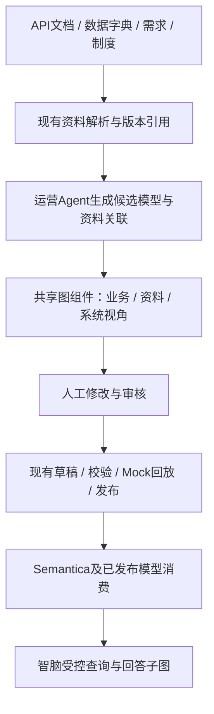

# Ontology Playground 与元域平台融合方案

最新候选对象、关系、字段修订与只读依赖检查统一见[融合当前状态](../development/ONTOLOGY_FUSION_CURRENT_STATUS.md)；本页不重复维护逐轮进展，验收依据见当前状态页中的报告链接。

2026-10-10结构探索增强：已声明读取步骤上的有界多跳映射发现接入对照向导。每跳必须有明确关系、两端字段引用、版本、维护人和UTC时点，最大4跳；循环跳过、歧义及预算失败均不生成执行计划。过滤/前置条件不自动求值，更不会自动授权业务读取。这是限定的自动路径发现，不是通用递归转换或OWL等价推理。

2026-10-10最终协作增量：企业资料逐人指派、转派/退回审核池、泛化站内提醒、受限人工意见与保留归档已经实现；统一保留来源独立授权、当前IAM资格、职责分离、CAS及事务出箱。外部OA/钉钉通知、通用OWL、自动递归映射等仍不能算完成，历史轮次的未完成表述以[当前状态](../development/ONTOLOGY_FUSION_CURRENT_STATUS.md)覆盖。本次按要求在回归后提交推送。

2026-10-10归档及映射补强：资料保留归档已从后续项落地，事务移转终态指针、历史读取复验来源；明确多系统双映射正/反向与分叉失败闭环已补齐。后端映射属性允许列表与前端对齐，未知脚本/URL/递归配置拒绝而非忽略。自动递归、通用OWL、资料逐人指派等仍不是完成范围，见[状态与剩余项](../development/ONTOLOGY_FUSION_CURRENT_STATUS.md)。

2026-10-10资料协作增量：限定企业WeKnora来源的协作核对已落地，按每位读取者独立授权回读，不复制私有笔记或原文，不把核对当发布。审核与保存权限、双人职责分离、来源版本、CAS和事件事务保留。资料逐人指派、外部通知和归档未接入；不等同于通用企业知识审批。见[最新状态](../development/ONTOLOGY_FUSION_CURRENT_STATUS.md)。

2026-10-10后续增强补齐：模型审核逐人指派/转派、定向提醒、团队视图历史归档及Windows原生目录/便携启动回归；不共享私有知识资料，不扩大审核权限。最新剩余范围与验收以当前状态入口为准。

2026-10-10续轮已补齐限定Turtle交换、团队审核布局快照、明确反向MDM读取和路径索引优化。下文“不支持Turtle”“逆向待开发”等表述保留当时计划含义；最新开发、回归及真实验收边界见[增强验收](../development/ONTOLOGY_ENHANCEMENT_ACCEPTANCE_2026-10-10.md)。不包含通用OWL、递归规则执行或共享私有知识资料。

当前状态入口：[融合当前状态与剩余项](../development/ONTOLOGY_FUSION_CURRENT_STATUS.md)。下列早期方案与续轮清单保留历史；跨刷新视图、限定RDF/XML及关系资料关联已在后续完成，不应重复计作未开发。提交状态已更新为3532caf已推送。

日期：2026-10-09  
状态：OP-01～12 的本轮可开发首版已实现并完成 Mock/组件回归；格式、资料共享和真实服务验收边界见下文。未作完整生产上线承诺。  
适用：元域智语语义运营端、智脑业务工作台、共享知识资料组件。

## 首轮实施记录（2026-10-09，历史）

OP-01/02 的首版已接入模型总览：搜索、来源筛选、邻居视图、缩放、拖动、节点与关系详情、有向路径高亮。OP-03 已接入 Agent 审核任务及候选编辑区，选中对象仍联动原字段编辑器，提问仅填写输入框，不自动发送或执行。OP-04 已显示服务端提案的新增/修改/删除标记，替换模式补齐被移除关系；未保存编辑不显示旧提案差异。关系属性修改的完整差异及前后值对照仍待补充。

OP-05 已实现资料片段到草稿对象的人工确认、存储、撤回及失效核验。关联绑定资料引用与模型指纹；当前按租户、主体和角色私有隔离，不是企业共享知识库。模型变化或来源失效后不显示旧摘录；同次响应中发生撤权则拒绝整图。尚未实现 Agent 自动建议、关联到模型关系，以及团队共享审核。

采用自行编写的 Vue/SVG 组件，未复制上游源代码、未新增 Cytoscape 依赖，也没有宣称支持 Fabric IQ。图中的结构路径不是实时业务影响结论。OP-06～12 在首轮未覆盖，已在后续实施中补齐下表所述首版。

操作与验证见[本轮实施及回归记录](../development/ONTOLOGY_PLAYGROUND_IMPLEMENTATION_REPORT.md)。

第二次对比后的 UX-01～10 有界首版及增强限制见[工作区深化计划](../development/ONTOLOGY_WORKSPACE_UPGRADE.md)。首轮历史中的“未支持”不代替当前状态：个人跨刷新视图、限定RDF/XML、行业Mock材料与可选资料模型分析已补充，仍不是完整上游兼容或真实企业验收。

## 续轮完成清单（2026-10-09）

上游参考版本固定为 GitHub HEAD `42a5e5ec170c1e76343886b9d5ba7a55959cb112`，只读查询所得；仅借鉴交互，不移植源代码。

| 项目 | 本轮落地及验收边界 |
| --- | --- |
| OP-01～03 | 搜索、邻居、拖动缩放、详情、Agent 内嵌审核图；大图默认100节点，可主动扩大到最多500或搜索目标 |
| OP-04 | 关系属性前后值、基数、证据、映射及删除差异；确认后的同名关系修改真正应用到草稿 |
| OP-05 | 对象与关系级资料依据；Agent 的有界明确名称匹配建议、人工确认、撤回、版本失效与撤权复验。建议不调用大模型、不直接保存；资料继续私有隔离，不开放团队共享原文 |
| OP-06 | 按对象展开来源系统、来源表/API、字段映射、主键和声明引用；未配置来源明确显示缺口，不伪称实际连接已通 |
| OP-07、11 | 采购收货、生产质量、仓储履约、OA 内部事务四模板，冲突提示及上手路线；带入 Agent 输入，不替用户选择系统或自动授权 |
| OP-08 | 明确对象问题定位有向路径；数量与金额问题转只读业务计划说明，同名或短名称包含匹配需澄清 |
| OP-09 | 已发布模型授权读取后生成实例子图；只用本轮来源记录和声明外键严格匹配，不补造缺失目标，不证明根因；图预算超限明确告知 |
| OP-10 | RDF JSON-LD 中 OWL 类及对象关系的受支持子集；主键/字段/基数作为元域注解。原文、转换与损失报告交给 Agent 核对，不直接写入。远程上下文、Turtle、RDF/XML、任意 OWL 推理不在支持范围 |
| OP-12 | 当前模型指纹与对象的应用内定位链接；打开后先登录和授权，版本/对象不匹配拒绝定位，不通过链接读取历史模型 |
| 独立布局 | 模型总览可显式保存本次页面会话的布局；跨视图保留，刷新/重登不保留，模型指纹不匹配不恢复；不修改语义指纹或发布版本 |

这些是本轮软件首版的完成状态，不等于真实企业联调或全格式兼容。真实方舟、真实 WeKnora、企业原始资料、逐人指派/团队资料共享、跨刷新布局持久化仍需专门验收或扩展授权；不混入本轮“完成”统计。

## 1. 融合目标与选型

把业务对象、资料依据和来源系统放在同一套可交互图谱中，让用户能够看懂、核对、修改模型，并沿图追溯依据。模型生成和修改仍由运营 Agent 协助，审核与发布使用现有治理流程。

推荐采用“借鉴交互、适配图组件、复用现有后端”的路线。Ontology Playground 使用 React，我们的运营端及共享组件使用 Vue；整站嵌入会形成两套界面状态、账号上下文和编辑流程。建议在 Vue 内封装图组件，评估使用它采用的 Cytoscape.js 与布局方案，以适配层读取元域现有模型。

上游的实体/属性/有向关系表达，以及点击查看详情的方式，可作为设计参考。[上游本体编写指南](https://github.com/microsoft/Ontology-Playground/blob/main/docs/authoring-guide.md)提供相应约定；[嵌入指南](https://github.com/microsoft/Ontology-Playground/blob/main/docs/embed-guide.md)提供独立查看器的使用方式。上述文档作为参考，本文提出的权限、证据关联及双 Agent 流程属于元域扩展设计。

| 融合方式 | 适用范围 | 决策 |
| --- | --- | --- |
| 嵌入上游整站或 iframe | 内部体验、公开教学示例 | 不作为企业编辑主入口；无法直接复用元域审核与权限状态 |
| 自托管上游独立查看器 | 独立只读演示 | 可做短期验证，须验证主题、交互事件、加载方式及租户数据传递 |
| Vue 图组件 + 元域模型适配层 | 正式建模、审核、知识关联和业务溯源 | 主方案；复用一套后端模型、版本与治理服务 |

实施前固定所参考的上游 commit，核对实际复用文件及许可证。若移植上游代码，保留相应版权与许可证声明；仅借鉴交互也应在设计记录中标明来源。当前未安装图依赖、未移植上游代码，不能据此宣称已兼容 Fabric IQ。

## 2. 现有基础与缺口

| 环节 | 当前基础 | 本次要补的内容 |
| --- | --- | --- |
| 模型总览 | 已展示对象和关系，技术配置在高级区 | 可缩放画布、邻居展开、路径高亮、按业务领域筛选 |
| Agent 建模审核 | 已有提案、审核待办、自然语言修改及采纳流程 | 对话消息内的交互式模型卡片、选中对象作为本轮上下文、图形差异预览 |
| 知识资料 | 已按来源归类，可校对原文、检索和复验引用 | 持久化资料片段与对象/关系的关联，确认、失效及重新核对流程 |
| 来源系统 | 已有接入、映射、流程语义及 Mock 材料链路 | 将系统、表/API、字段映射按需展开到对象旁边 |
| 版本 | 已有草稿快照、差异与指纹约束回滚 | 用图显示新增、删除、修改；视觉布局与语义版本分开保存 |
| 智脑消费 | 已有已发布模型、受控读取及回放路径 | 回答中显示本轮实际读取的关联子图与证据 |

当前知识资料地图的连线仅表示同一来源归类。文档标题类似、对象名称相同或模型给出高置信度，都不能直接建立已确认的业务关系。

现状依据：[语义建模说明](SEMANTIC_MODEL_AUTHORING.md)、[知识资料指南](../guides/KNOWLEDGE_WORKSPACE_GUIDE.md)、[发布模型消费指南](../guides/PUBLISHED_MODEL_WORKBENCH.md)。历史文档中部分多人审核描述存在阶段差异，实施时以当前服务端权限判断及回归测试为准。

## 3. 拟融合的功能

| 编号 | 功能 | 融合方式与具体改进 | 用户得到的结果 | 优先级 |
| --- | --- | --- | --- | --- |
| OP-01 | 交互式模型图 | 复用图形引擎思路，支持缩放、拖动、复位、节点搜索、邻居展开 | 能直接看到“供应商提供原料，原料用于生产批次” | P0 |
| OP-02 | 点击式详情 | 选中节点显示业务含义、来源和确认状态；字段、主键与技术配置折叠 | 查看模型无需先理解数据库术语 | P0 |
| OP-03 | Agent 内嵌审核图 | 同一图组件以紧凑模式放入审核任务消息，点击后可放大 | 在任务内完成看图、提问、要求修改与审核 | P0 |
| OP-04 | 图形差异 | 提案与基线比较，新增/修改/删除同时使用颜色、标识和文字说明 | 用户知道本轮究竟改了什么 | P0 |
| OP-05 | 资料与模型关联 | 新增有来源版本和定位的关联记录；Agent 可建议，用户确认 | 选中采购订单可看到对应制度、API 文档及字典依据 | P0 |
| OP-06 | 跨系统映射图 | 展开对象所属系统及映射链路，显示关联键、类型和是否完整 | 能解释 ERP、WMS、MES、OA 如何围绕同一业务协作 | P1 |
| OP-07 | 业务模板目录 | 借鉴目录/模板交互，优先采购、生产质量、仓储履约、OA 内部事务 | 从业务问题出发生成小规模候选模型 | P1 |
| OP-08 | 问题驱动的图导航 | “订单和原料有什么关系”定位模型路径；需要实际数量时转受控查询 | 问题与图中对象、关系对应起来 | P1 |
| OP-09 | 智脑回答子图 | 将本轮已授权读取记录和来源组织成结果子图 | 能看清受影响订单、批次和责任人如何关联 | P1 |
| OP-10 | RDF/OWL 交换 | 实现受支持子集的导入预览、字段映射、损失报告和导出 | 可复用外部模型材料，清楚哪些信息被保留 | P2 |
| OP-11 | 引导式上手 | 按“选场景—看图—改关系—验证—发布”引导，配合合成样例 | 新用户可以按一个业务任务完成体验 | P1 |
| OP-12 | 可分享模型视图 | 保存模型版本与选中节点的应用内定位链接，打开时重新授权 | 同事进入相同版本和问题位置 | P2 |

P0 为第一轮闭环必需项，P1 扩展业务覆盖，P2 做互操作与协作完善。上游课程、积分任务、GitHub 自动提交、Azure AI Builder 暂不进入主产品；已有 Agent、模型网关和内部治理服务继续承担对应职责。

## 4. 用户看到的页面

### 4.1 语义运营：图谱为主，对话与详情按需展开

页面顶部只保留场景、版本状态、搜索和主要操作。中央为图谱，右侧按选中内容显示详情；Agent 对话可在侧边展开，审核任务中的图与模型页共用组件。

提供三个视角，切换时保留所选业务对象：

| 视角 | 默认展示 | 点击之后 |
| --- | --- | --- |
| 业务关系 | 对象、业务动词、必要的基数 | 看定义、邻居、关系依据，提出修改 |
| 资料依据 | 已关联资料与选中对象，候选关联单独标注 | 打开原文定位、确认或拒绝关联 |
| 系统来源 | 系统、源对象与映射关系 | 查看 API/字段、关联键、映射缺口 |

默认只展示当前业务主题的核心子图；大型模型通过领域折叠、邻居展开和路径查询逐步查看，不能将所有对象、字段和资料一次铺满画布。找不到对象时明确显示搜索结果，不静默隐藏筛选范围。

### 4.2 知识资料：从“管理文件”转向“理解业务”

顶部保留“添加资料”“搜索”“待确认关联”。选中一个业务对象后，展示支撑它的资料、相关对象，以及尚未确认的候选关联。

例如选择“采购订单”，可看到《采购管理制度》解释审批规则、ERP API 文档定义订单接口、字段字典说明订单编号，再看到它与供应商、收货单、审批实例的关系。每条关联都可回到具体资料版本和片段。

没有确认关联时显示“待关联资料”列表，并提供“让 Agent 建议关联”的操作。请求需明确资料及模型范围；现有资料是主体/角色隔离的，团队共享资料应另有授权配置，不能因进入公共模型图而自动扩大可见范围。

### 4.3 审核任务：让用户核对关系与变化

Agent 的审核卡片展示业务目标、模型子图、本轮变更、待确认问题。用户可直接说：

- “采购订单可以分多次收货，改成一对多。”
- “这个供应商依据来自哪份资料？”
- “去掉门店，只看仓库发货之前的部分。”
- “审核通过。”

修改先形成新提案，图中高亮变化；审核动作绑定当前提案修订和模型指纹。发布沿用现有权限与校验入口。用户只问关系或解释时，不改变模型状态。

### 4.4 智脑：围绕回答显示结果图

智脑沿已发布模型读取业务数据，再把本轮用到的记录、关系和引用显示为子图。节点展示业务实例，例如“原料批次 RM-MOCK-001”；运营建模图展示类型，例如“原料批次”。两者使用不同模式和清楚的标识。

“看见一条影响路径”只证明当前数据中的关联；是否为根因需要额外事实支撑。智脑的建议引用真实读取结果，并说明数据缺失和查询范围。

## 5. 技术融合与数据设计

### 5.1 数据流

### 5.2 图形适配层

元域语义模型作为权威数据。适配层将 `objectTypes`、`relationshipTypes`、来源映射及资料引用转换成显示节点和边，不再保存一套独立的本体业务定义。

节点以类型加稳定 ID 标识，如对象、资料修订、系统、业务实例分别有独立命名空间；边保存关联类型和原始引用。类型对象与实例对象不混用 ID。只有服务端允许返回的数据进入图的节点、边、搜索结果和详情。

节点坐标、缩放和折叠状态是用户视图偏好，单独保存，不纳入业务语义指纹。对象定义和关系基数的变化才进入模型变更流程。图上拖动仅移动布局；创建连线需要明确选择关系和提交语义修改。

新增共享组件位置建议为 `packages/agent-ui/src/ontology-graph/`，通过具名包入口导出；组件仅接收显示数据并发出选择/修改意图。网络调用由各端 SDK 负责，治理逻辑留在后端。若共享 UI 包触及既有模块化拆分阈值，应先抽独立图谱包，按现有架构约束执行。

### 5.3 新增资料关联记录

建议独立保存 `KnowledgeModelLink`，字段包括：

| 字段组 | 含义 |
| --- | --- |
| 范围 | tenantId、资料所属主体/角色范围，由服务端确定 |
| 资料引用 | 提供方、文档 ID、修订、片段定位、内容摘要指纹 |
| 模型引用 | 模型 ID、模型修订或指纹、对象 ID/关系 ID |
| 关联含义 | 定义依据、规则依据、字段说明、流程说明等受支持类型 |
| 生命周期 | 候选、已确认、已拒绝、待重新核对、已撤回 |
| 证据与审计 | 对应摘录、生成方式、确认人、时间、前一修订 |

模型给出关联建议后，后端复验资料引用和目标模型，用户确认才进入已确认状态。资料修订、撤回、权限变化或关联对象被删除时，旧关联不能继续作为当前依据。保留历史可追溯记录，当前图显示失效原因；再次使用时复验，不能仅依赖前端缓存。

未来可为模型发布保存当时的证据关联集合，但保留版本引用不代表拥有继续查看已撤权原文的权限。

### 5.4 Agent 与图的交互契约

对话请求携带当前任务、模型版本、所选对象/关系和显式系统范围。服务端重新检查引用及可见范围后交给模型；不会把完整画布或整库资料默认塞入提示词。

回答可携带结构化图操作意图：定位对象、展开邻居、高亮已验证路径、展示修改提案。图组件根据允许的动作更新视图，不执行模型输出代码或任意查询。多标签页发生版本冲突时保留用户输入，要求基于最新版本重新审阅。

### 5.5 模板与格式交换

模板只带业务类型、关系与必要说明；企业系统映射、组织权限和真实实例须在接入阶段确定。导入模板时预览与当前模型的冲突，不自动覆盖同名对象。

RDF/OWL 先支持明确的实体、属性、关系子集。元域的系统映射、治理策略、时态条件和读取方案未必能无损表达；导入导出都要列出未支持内容。保留原始导入材料及转换报告。针对支持子集验证往返一致性，不作通用 OWL 推理或全量兼容承诺。

## 6. 分阶段清单与完成条件

| 阶段 | 主要工作 | 完成条件 |
| --- | --- | --- |
| S0 契约与小样 | 固定参考版本；用现有模型生成图数据；确认类型/实例/资料三类标识与性能样本 | 同一组对象和关系在新旧视图数量与含义一致，无额外业务状态副本 |
| S1 可视化审核 | OP-01～04；模型页与任务消息复用图；自然语言修改与图形 Diff | 在 Agent 任务中完成查看、修改、重新审核；过期提案拒绝应用 |
| S2 知识关联 | OP-05；关联建议、原文校验、人工确认、失效和版本追溯 | 资料可定位业务对象，对象可回到依据；撤回与权限变更后旧引用失效 |
| S3 系统及智脑联调 | OP-06、08、09；跨系统映射视图与已发布数据消费 | 同一 Mock 场景从材料建模到智脑回答；图和答案共用计算结果与证据 |
| S4 模板及上手 | OP-07、11；四类业务模板和完整体验引导 | 新用户用合成材料完成一个业务主题，能解释核心关系并识别故意设置的错误 |
| S5 交换与协作 | OP-10、12；格式支持清单、应用内定位链接 | 支持子集往返一致；不支持项显式报告；分享链接重新检查权限 |

所有阶段先用 Mock 材料完成开发和回归。排期应在 S0 形成组件验证、后端关联契约和工作量拆分后估算；当前不承诺未经验证的交付天数。阶段通过后同步更新能力范围、操作指南与测试报告。

## 7. Mock 验收场景

准备一个虚构制造零售企业，提供 API 文档、需求说明、字段字典、采购制度、流程定义与实例样本。初始模型覆盖供应商、采购订单、原料批次、生产批次、库存、调拨单、门店、销售订单、财务凭证和人员；通过业务视角拆成可阅读的小图。

| 场景 | 操作与预设问题 | 验收结果 |
| --- | --- | --- |
| 采购收货 | ERP 一张订单对应 WMS 多次收货；候选故意写成一对一 | 审核人从图中识别错误，自然语言修正为一对多，Diff 可见 |
| 原料影响 | 一个原料批次进入多个生产批次，再发往多个门店 | 智脑图和答案的批次/门店/订单集合与预置期望集合一致，重复路径不重复计数 |
| OA 跨系统审批 | 采购申请与 ERP 订单通过业务编号关联，存在被驳回流程 | 区分流程状态与订单状态，不把驳回实例解释为已获批准 |
| 资料冲突 | 两版制度具有不同审批阈值或不同适用组织 | 并列提示冲突、显示适用范围与依据，不自动选一份作为权威 |
| 材料修订 | 修改或撤回已确认关联的资料片段 | 关联进入待核对/撤回状态，旧回答重用时不能读取无效引用 |
| 同名对象 | 两个系统存在同名但不同业务含义的“客户” | 保持来源身份，需明确映射才能合并 |
| 并发审核 | 两人基于同一版本修改关系，先提交其中一份 | 第二次提交检测版本变化，不覆盖先提交内容 |
| 权限隔离 | 不同租户、角色及资料主体访问同一深链 | 节点、边、详情和原文均遵守访问范围，页面隐藏不能替代服务端检查 |
| 模型与实例 | 询问“有哪些对象”与“本批影响多少订单” | 前者解释模型结构，后者执行实例读取；不能用图节点数量回答订单数量 |
| 展示性能 | 合成 20/100/300 节点、40/200/600 边；在 1366×768 和 1920×1080 测量 | 无布局溢出、可定位目标、面板不遮挡操作；记录加载/布局耗时，300 节点可退为分区展开。样本不改变后端模型规模上限 |

S1/S2 验证不需要真实模型费用；以确定性提案夹具检查交互和状态迁移。S3 分别记录 Mock 模型与真实方舟模型运行结果，真实调用失败不能被 Mock 通过覆盖。测试报告应记录使用的模型版本、数据指纹、预期/实际路径、异常分支及未通过项。

## 8. 文档与实施边界

本轮已交付 S0～S5 的上述受限首版；功能与状态以顶部完成清单为准，后文保留原设计目标。操作见[图谱建模工作台指南](../guides/ONTOLOGY_GRAPH_WORKSPACE_GUIDE.md)。

落地时应同步维护：

- [语义建模说明](SEMANTIC_MODEL_AUTHORING.md)：图与模型版本、审核发布的对应关系。
- [知识资料指南](../guides/KNOWLEDGE_WORKSPACE_GUIDE.md)：资料关联、引用状态及操作。
- [语义运营能力范围](../overview/SEMANTIC_OPERATIONS_CAPABILITY_SCOPE.md)：已完成与待验证功能。
- [智脑能力范围](../overview/ZHINAO_CAPABILITY_SCOPE.md)：回答子图的读取边界。
- 阶段测试记录：新功能对应的 Mock 材料与双端回归结果。

参考项目：[Ontology Playground](https://github.com/microsoft/Ontology-Playground)。未部署或移植上游整站；已在元域代码中实施上述适配功能。遵照用户要求，本轮不提交、不推送 Git。
# 最新落地状态（2026-10-09）

2026-10-10续轮已实现明确字段修订、新候选字段新增/受限撤回、最多8项原子批量修订及明确类型关系新增。新增关系保持声明型，不生成跨系统数据匹配；修改只进入候选，人工确认后才进入未发布草稿。验证与剩余增强以[当前状态](../development/ONTOLOGY_FUSION_CURRENT_STATUS.md)为准；下方外部服务状态是2026-10-09历史，Semantica已在10日完成真实临时实例验证，方舟真实回答质量尚未验收。

本轮沿用模块化单体与共享Vue组件，没有移植上游整站。限定融合能力已增加业务域与来源总览、原始关系下钻、有界对象避障、精确诊断、对象指纹上下文交接及同候选连续属性修订。详见[补强计划及阶段记录](../development/ONTOLOGY_WORKSPACE_UPGRADE.md)。下文早期对比中的缺失项为当时状态，不能当作当前结论。

外部验收独立保留：方舟实际检查返回`ARK_ACCOUNT_OVERDUE`，Semantica当前不可用；真实企业SSO、MDM、生产发布与模型回答质量不能由Mock通过代替。任意OWL、任意规模无交叉图、逆向/递归映射和任意自由文本修改属于后续范围，不伪称本轮完成。
