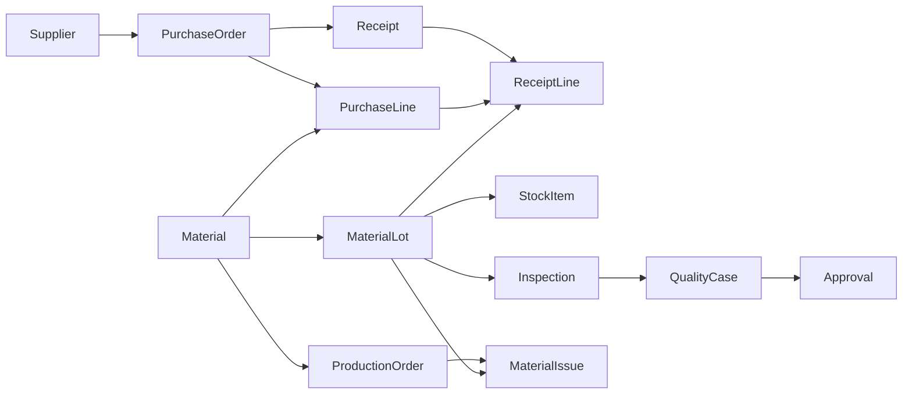

# 真实业务规则驱动的语义建模模拟报告

更新说明（2026-09-10）：本文保留修复前证据。SM-01–SM-10 的修复状态、复测结果及边界以 [修复与回归报告](SEMANTIC_MANUFACTURING_REPAIR.md) 为准；下文“未修复”描述的是首次评测时点，不是当前状态。

日期：2026-09-10。结论：**底层模型能够较快理解本案例的业务与数值关系，但当前运营链路尚不能可靠地把这些理解转化为完整、可绑定事实的业务世界模型。**

本次不是“13 张表生成成功”的演示：同时检查了对象来源、粒度、外键、历史材料保留、分批合并、业务口径及实际 Semantica 建图结果。问题未通过修改生产代码掩盖；已形成待修复项。

## 1. 真实性与隔离范围

| 项目 | 本次实际做法 |
| --- | --- |
| 业务依据 | Odoo 官方公开的分批收货、收货/质检/入库分离及批号追踪流程；出处与改编范围见 [需求文档](SEMANTIC_MANUFACTURING_REQUIREMENTS.md) |
| 企业与数据 | 虚构精密零部件工厂；6 个系统、13 类对象、17 条类型级外键关系、20 次投递（19 条唯一记录） |
| 输入 | 6 份分系统 OpenAPI、1 份综合 OpenAPI、1 份字典、需求规则、事件样本 |
| 模型 | 真实火山方舟 `doubao-seed-2-1-pro-260628`；预检通过；T1–T9 的语义任务 routing.source 均为 ark |
| 产品路径 | 直接调用现有 `createSemanticOperationsTask`，经过实际附件准入、文本提取、上下文、意图、规划和候选生成路径；结构化附件的候选抽取包含确定性解析，不能全部称为大模型生成 |
| 图引擎 | 实际 `semantica.ContextGraph`，独立 Python 进程；调用现有语义服务的定义校验函数，没有使用 projection fallback |
| 状态隔离 | 测试内存存储、合成身份；未采纳提案、未发布模型、未调用企业接口；初始/最终平台草稿指纹一致 |
| 安全范围 | 合成文本/JSON 可发送给已配置的方舟；开发基础扫描，不是企业 DLP 验收；没有将密钥打印或写入材料 |
| 未覆盖 | 浏览器交互、Electron 壳层、真实企业 API、企业权限联调、图片/音视频、生产全量历史与持续运行 |

本报告的“真实”指真实模型与引擎、真实代码路径及有公开业务依据的模拟，不代表取得客户生产记录或部署了真实 ERP。

## 2. 目标世界模型应该包含什么

本案例要求的不只是实体关系图，还包括对象粒度、权威来源、数量单位、状态与动作、指标口径和证据时间。

| 系统 | 预期对象 | 关键含义 |
| --- | --- | --- |
| ERP | Material、Supplier、PurchaseOrder、PurchaseLine | 主数据与交易分层；订单头金额不随明细连接重复汇总 |
| WMS | Receipt、ReceiptLine、MaterialLot、StockItem | 收货单与明细、来料批次、批次/库位库存相互区分 |
| LIMS | Inspection | 检验结果是事实，不自动等于放行决定 |
| QMS | QualityCase | 异常与处置进度，关联具体批次和检验 |
| MES | ProductionOrder、MaterialIssue | 生产需求与实际领料分开，计划不充当消耗证据 |
| OA | Approval | 审批状态与外部执行回执分开 |

下面是人工验收基准中的关系主线，不是 Agent 自动生成结果；完整 17 条关系见 [验收基准](../../examples/semantic-schemas/manufacturing-case/expected-world-model.json)。



图中箭头为人读业务关联方向；JSON 基准以外键持有方指向被引用方的 n:1 关系记录，不将箭头视为执行顺序或因果证明。

## 3. 测试顺序与实际结果

T1–T8 串行总耗时 **130.412 秒**，不含前置材料准备、连通预检与 Python 建图。T9 单独补测为 **12.980 秒**。这些是本次单次样本时延，不是并发性能或生产 SLA。

| 编号 | 操作 | 耗时 | 实际结果 |
| --- | --- | --- | --- |
| T1 | 需求 + 字典，要求理解业务而不建模 | 25.856 秒 | 解释6个系统分工、分批收货、主数据/批次/库存区分及控制规则；ReceiptLine 在口头分类中被称为“事件”，与输入 transaction 粒度不一致 |
| T2 | 补事件样本，计算金额、收货、库存与缺口 | 23.336 秒 | 5个主要数值正确；识别重复事件、g/kg换算及120kg领料不能重复扣减 |
| T3 | 追问审批与异常批次实际消耗 | 19.971 秒 | 正确指出审批不等于放行；仅有 LOT-SYN-A 的实际领料证据，没有 LOT-SYN-B 被消耗的证据 |
| T4 | 不重新上传，沿用前文生成13对象候选 | 11.137 秒 | needs_input；历史材料已经截断，要求重新上传，没有生成不完整模型 |
| T5 | 仅综合 OpenAPI 建模 | 12.655 秒 | 13对象/13主键保留，但仅1对象来源正确，粒度0/13、关系0/17；Critic仍passed |
| T6 | 综合 OpenAPI + 字典 + 需求建模 | 12.102 秒 | needs_input；综合API文本17496字符，被分配到11300字符预算而截断 |
| T7 | 第一批 ERP/WMS API 建模 | 12.671 秒 | 8对象，8来源正确，但关系0条；映射演练failed/blocked=true |
| T8 | 第二批 LIMS/QMS/MES/OA，要求与前批合并 | 12.665 秒 | 仅保留新批5对象，前批8对象没有进入新候选；完整模型缺失，Critic仍passed |
| T9 | 仅数据字典 + 需求建模，避开多文件预算 | 12.980 秒 | 13对象、13主键、17条关系保留；仍只有1来源正确，粒度0/13，Supplier被映射Person |

9个任务均有真实方舟参与，但结构化候选字段来自产品解析器；不能用模型接入成功证明解析器正确，也不能把 T4/T6 的安全阻断算作业务建模成功。

### 3.1 大模型理解与计算的核对

下列为人工核对的本次回答，不是将预期答案提前发送给模型：

| 指标 | 合成样本正确答案 | T2回答 |
| --- | --- | --- |
| 采购订单头金额 | 10,000 CNY | 正确，没有在连接明细后重复累计 |
| 去重累计收货 | 1,000 kg | 正确：600kg + 400000g/1000；重复投递不计两次 |
| 当前账面库存 | 880 kg | 正确：480 + 300 + 100 |
| 当前可用库存 | 400 kg | 正确：隔离批次400kg账面量不算可用 |
| MO-SYN-01缺口 | 100 kg | 正确：500需求减400可用；预留量不重复分配 |

T3正确核对 `execution_receipt_id=null`、`HOLD` 和实际 `MaterialIssue.lot_id`。这说明本例的业务理解并非主要短板；仍不能据一次回答推导其对任意企业材料都可靠。

## 4. 用真实 Semantica 验证候选后果

对生成候选，使用本次新增的独立诊断脚本，按照候选声明的类型、主键、来源与外键绑定合成事件，再交给实际 ContextGraph 建图。脚本不会补正错误来源、不从预期答案给 Agent 候选补关系。人工参考模型单独运行，用于确认引擎及样本本身是否可工作。

| 输入定义 | 结构校验 | 唯一记录绑定 | 实例节点 / 边 | 结论 |
| --- | --- | --- | --- | --- |
| T5 综合 API 候选 | passed | 1/19 | 1 / 0 | 全部对象被标为OA，仅OA审批记录匹配，其余18条拒绝 |
| T8 分批合并后的候选 | passed | 6/19 | 6 / 0 | 缺ERP/WMS对象，也缺关联，无法组成跨系统模型 |
| T9 字典候选 | passed | 1/19 | 1 / 0 | 类型关系虽有17条，来源错误使事实无法绑定 |
| 人工字典参考模型，非Agent产物 | passed | 19/19 | 19 / 26 | 去重1次，按样本实际外键建26条实例关系，检索异常批次有6项命中 |

T4/T6没有候选，不进行建图。17条是类型层关系；26条是本次19条记录产生的实例关系，两者不能混为一个指标。

**结构校验通过，不代表业务世界模型正确。** Semantica 能组织这个案例；目前缺的是可靠的语义提取、来源保真、材料版本合并和基于事实的准入门禁。本轮没有将人工参考模型包装成产品已自动建模成功，也没有发布任何模型。

## 5. 问题清单与建议修复顺序

以下全部未修复。P1表示阻断本案例的可靠快速建模，P2表示体验或解释口径问题，不代表已发生生产安全事故。

| ID / 优先级 | 复现与影响 | 实现依据 / 建议 |
| --- | --- | --- |
| SM-01 / P1 | T5/T9将13对象全部标为OA，来源正确仅1/13；18/19事实不能绑定 | `semantic-schema-discovery-service.js` 从文件名/请求选择单个系统，忽略逐对象 `system`、`x-source-system`。优先使用明确声明，缺失时待确认，不以关键词覆盖材料 |
| SM-02 / P1 | T5/T7的标量外键全部丢失，预期17条关系未建立 | OpenAPI解析仅把 `$ref` / `items.$ref` 当关系，不解析标量外键扩展或显式说明。建立受支持的外键契约及证据候选；不可把标量ID伪装成嵌套对象 `$ref` |
| SM-03 / P1 | T5/T9显式粒度0/13保留，Supplier被锚定Person | 结构化候选不带 `granularity`，锚点靠关键词猜测。保留来源粒度，优先独立业务类型，对主数据/批次/库存项做强约束 |
| SM-04 / P1 | T8只剩新批5对象，前批8对象丢失，虽明确要求合并仍生成“可审阅”候选 | 当前建模以本轮附件抽取，不合并父任务候选/材料版本。引入任务级材料清单、增量合并、删除声明及冲突队列，不能依靠聊天复述旧结构 |
| SM-05 / P1 | T4原文件读取报告完整，但材料记忆压到12000字符，后续不能建模 | `semantic-operations-task-service.js` 仅保存有界文字材料。需要持久材料引用、对象索引和按需检索；保留当前截断失败关闭机制 |
| SM-06 / P1 | T6两份普通JSON一起传入即被均分预算截断，解析链路整体阻断 | `multimodal-input-service.js` 按附件数均分24000字符预算；完整结构解析与LLM摘要预算耦合。结构化解析应独立于展示/模型摘要预算，长材料分层检索 |
| SM-07 / P1 | 同名PurchaseOrder两份字典主键冲突，调换附件顺序就从po_id变成external_po_id，warnings仍为空 | 补充确定性诊断两次均复现；对象去重 `Map` 以后者覆盖前者。保留来源版本，对主键、类型、单位、来源变化显式冲突审阅 |
| SM-08 / P1 | T5/T8/T9 Critic passed，映射 partially_verified且blocked=false；独立语义校验同样通过错误业务定义 | 现有检查重格式、目录允许列表和引用闭合；零关系可空集合通过。增加需求对象/关系覆盖、逐来源对照、事实样本覆盖及能力问题回放门禁；不要泛称“已验证” |
| SM-09 / P1 | T9可提取关系，但需求中的状态、单位转换、金额口径、权限与动作边界没有形成结构化世界模型资产 | 当前提案主要保存objectTypes/relationshipTypes，缺需求→状态/指标/规则/动作的可追溯编译流程。先输出带原文证据的待审阅资产，再由受控规则实现，不执行任意表达式 |
| SM-10 / P2 | T1将字典transaction粒度的ReceiptLine口头解释为事件粒度 | 单次回答口径漂移，建议业务摘要引用模型规范枚举并校对；尚不能认定所有回答都会复现 |

SM-08不表示发生越权发布：本轮没有请求执行、没有确认、没有采纳；当前无样本已有warning，但不足以判定“业务模型正确”。SM-02的扩展是合成契约自定义约定，不声称 OpenAPI 标准规定了该外键字段。

### 修复顺序

1. **保真导入**：SM-01、02、03、07，先解决来源、外键、粒度和冲突，杜绝“对象看起来齐全但含义已变”。
2. **持续建模工作区**：SM-04、05、06，建立材料版本索引和可追溯增量合并，不反复整包重传。
3. **世界模型与验收门禁**：SM-08、09、10，需求、对象、事实、状态和判断规则共同验收。

建议目标：本案例13对象/13主键/13来源/13粒度与17关系全部保留；分批与一次性输入的语义结果一致；冲突改变顺序也不能静默采纳；全部19条唯一样本可绑定；数值与权限能力问题通过后再进入发布评审。时延先记录分阶段P50/P95，不承诺尚未测量的“一分钟生产建模”。

## 6. 复现与证据

在项目根目录执行。模型密钥继续从项目外配置读取，以下命令会消耗真实方舟推理额度；样本文件可公开审查但当前没有推送 GitHub。

```powershell
node scripts/ark-runtime.mjs --check
node scripts/evaluate-semantic-manufacturing.mjs
node scripts/evaluate-semantic-manufacturing.mjs --dictionary-only
node scripts/evaluate-semantic-material-order.mjs
.\.venv-semantica\Scripts\python.exe -X utf8 services/semantic-context/evaluate_manufacturing_case.py
```

先执行 Node 评测，再执行 Python。产物在 `output/semantic-manufacturing/`：T1–T9的输入、回答、附件范围、提案和检查结果，`summary.json`（T1–T8）、`order-conflicts.json`、`semantica-graphs.json`。`expected-world-model.json`只供评测，不送入模型；Python人工参考对照也不送入Agent。

首次T9在文件落盘后由评测脚本强制退出引起Windows libuv关闭断言；仅调整新增评测脚本为自然退出，复跑正常，表中采用复跑的12.980秒。生产服务未改。Python也没有修改用户正在运行的Semantica服务或发布状态。

原始回答只验证本次特定案例，不给出通用“智能分数”。本轮新增材料和评测脚本通过仓库lint与文档检查；未重新执行全部业务测试，也未补称UI验收通过。
