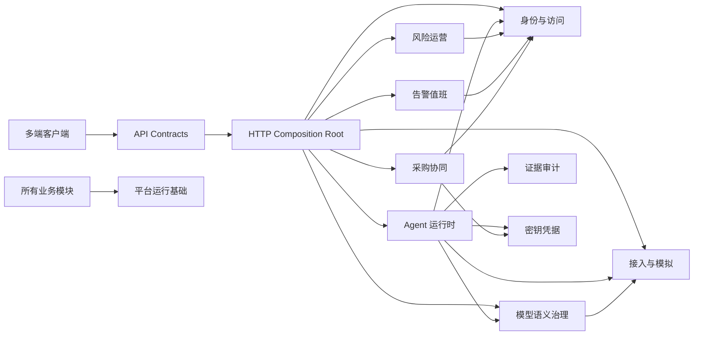

# 多人协同架构审视与优化方案

## 1. 结论

当前项目已完成第四阶段协作架构基线：除既有工作区、领域出口、契约和静态门禁外，风险、采购、IAM 与 Agent 工作项均能在聚合事务中写入领域事件，并提供独立 Worker、消费者租约和幂等检查点。角色目录通过 IAM 策略实时投影。后续重点是告警/模型事件接入、真实 Broker、其他配置来源统一和完整响应 Schema。

建议采用“模块化单体 + 可拆分基础服务”的演进路线：先在单仓内形成强模块边界和稳定契约，再按部署、隔离或伸缩需要拆出语义上下文、密钥中心、Connector Worker 和模型网关。当前阶段不建议把所有模块直接微服务化，否则会提前引入分布式事务、契约兼容和运维成本。

## 2. 现状评分

| 维度 | 评分 | 依据 |
| --- | --- | --- |
| 工作区划分 | 7/10 | 已有 `frontend`、`backend`、`packages/*`、`apps/*` |
| 领域模块化 | 8/10 | route adapter 只依赖领域 public-api；领域内部服务仍待物理归位 |
| API 契约 | 8/10 | OpenAPI 已覆盖 30 个核心操作和事件读取契约并自动解析校验 |
| 前端可并行性 | 8/10 | 页面加载与写动作均迁出 App，并有权限代际测试 |
| 数据所有权 | 7/10 | IAM 统一角色投影，风险/采购/IAM/Agent 聚合与事件同事务；其他配置仍有种子投影 |
| 测试隔离 | 8/10 | 80 项回归含契约、架构、事件 Worker、安全、模块与持久化入口 |
| 文档可发现性 | 5/10 | 文档丰富但原先平铺、版本和代码状态容易漂移 |
| 发布独立性 | 4/10 | 多数模块共享一个 API 进程，变更影响面未由契约测试控制 |

## 3. 主要结构问题

1. `backend/src/services` 内部文件仍平铺，但 HTTP 层已经只能通过 `backend/src/domains/*/public-api.js` 调用；下一步物理归位不能破坏公开出口。
2. `frontend/src/App.vue` 的 loader 和业务动作已下沉，动作已分为 risk/procurement、agent、governance、administration 四个领域文件。
3. 角色目录已由 `role-catalog-service` 合并 IAM 策略；系统连接、平台状态等配置仍存在种子与运行态投影。
4. `packages/api-contracts/openapi.yaml` 已覆盖 30 个主要跨端操作，但元模型、世界模型、Key 写操作和全部响应字段仍需继续补齐。
5. 语义服务和独立 Key Center 位于 `services/`，但未进入统一服务生命周期和跨语言契约测试。
6. ESLint、Vue/JS 类型检查和 CODEOWNERS 已建立；仍缺数据库 migration 和自动文档版本检查。

## 4. 目标依赖模型



依赖只允许从体验层指向契约层、从组合根指向模块公开 API、从业务模块指向明确允许的基础能力。禁止客户端直接依赖后端内部结构，禁止一个领域直接修改另一个领域的数据表或 Repository namespace。

## 5. 目标代码结构

```text
backend/src/
  app.js                         # 仅启动 server 与注册模块
  platform/                      # HTTP、配置、Repository、可观测性
  modules/
    identity-access/
      api/                       # route adapter + request schema
      application/               # use cases
      domain/                    # entities/policies/events
      infrastructure/            # repository/adapters
      index.js                    # 唯一公开出口
    agent-runtime/
    evidence-audit/
    ...
packages/
  api-contracts/                 # OpenAPI/JSON Schema/错误码/生成类型
  agent-sdk/
  agent-workbench/
frontend/src/features/           # 每个页面拥有 loader/actions/store
apps/desktop/                    # 容器，不复制业务实现
apps/mobile/                     # 容器，不复制业务实现
```

## 6. 模块规则

- 每个模块只通过 `index.js` 或事件契约暴露能力；其他模块不得 import 其内部文件。
- 每个数据集合只有一个 owner；跨模块查询使用只读端口、投影或领域事件。
- 每个写用例自行完成身份、按钮权限、数据范围、乐观锁和审计，不信任前端隐藏。
- HTTP route 只做解析、Schema 校验、调用 use case 和错误映射，不包含业务循环。
- 后端错误统一为 `{ message, code, requestId, details? }`；禁止把内部异常直接返回客户端。
- 所有公开 API 必须有契约测试，破坏性变更使用 `/api/v2` 或兼容字段迁移。
- 跨模块事件必须携带 `eventId`、`type`、`version`、`tenantId`、`organizationId`、`occurredAt`、`correlationId`。

## 7. Git 与协作策略

建议按模块分配 CODEOWNERS 和研发小组。一个需求分支尽量只修改一个领域模块；跨模块需求先提交契约 PR，再由各模块分别实现。PR 模板必须列出影响模块、API 兼容性、数据迁移、权限变化、审计变化和回滚方式。

推荐 CI 顺序：`npm run lint` → `npm run typecheck` → 模块单测 → API 契约 → 安全回归 → 集成测试 → 三端构建 → Electron/Tauri 打包抽检。静态门禁已落地，CI 平台接入时直接调用根脚本。

## 8. 分阶段迁移

### P0：协作基线

1. 已完成：把 `app.js` 业务路由迁入对应模块 route adapter。
2. 已完成：删除未使用的 `backend/src/routes/api.js`。
3. 已完成：新建 `packages/api-contracts`，覆盖核心身份、Agent 和风险契约并接入前后端。
4. 已完成：页面数据加载迁入 `frontend/src/page-data-registry.js` 并增加权限边界测试。
5. 已完成：引入 lint/typecheck、CODEOWNERS，OpenAPI 扩展到 30 个核心操作并增加解析/唯一性测试。

### P1：降低冲突

1. 已完成：`app-actions.js` 只负责组合，动作分入四个领域控制器。
2. 已完成第一步：所有 route 通过 `backend/src/domains/*/public-api.js` 调用；后续物理迁移内部文件。
3. 已完成角色目录和 IAM 策略统一；待统一系统连接与平台配置来源。
4. 已完成通用领域事件 Outbox、风险/采购/IAM/Agent 原子接入和独立幂等 Worker；待接入告警、模型发布和真实 Broker。

### P2：生产拆分

1. 将 SQLite 替换为 PostgreSQL/企业数据库并启用 tenant key、RLS、迁移工具。
2. 拆出 Connector Worker、模型网关、语义上下文和密钥中心。
3. 引入消息队列、幂等消费、重试、死信、租约与可观测性。
4. 建立 API/事件版本治理和模块发布矩阵。
