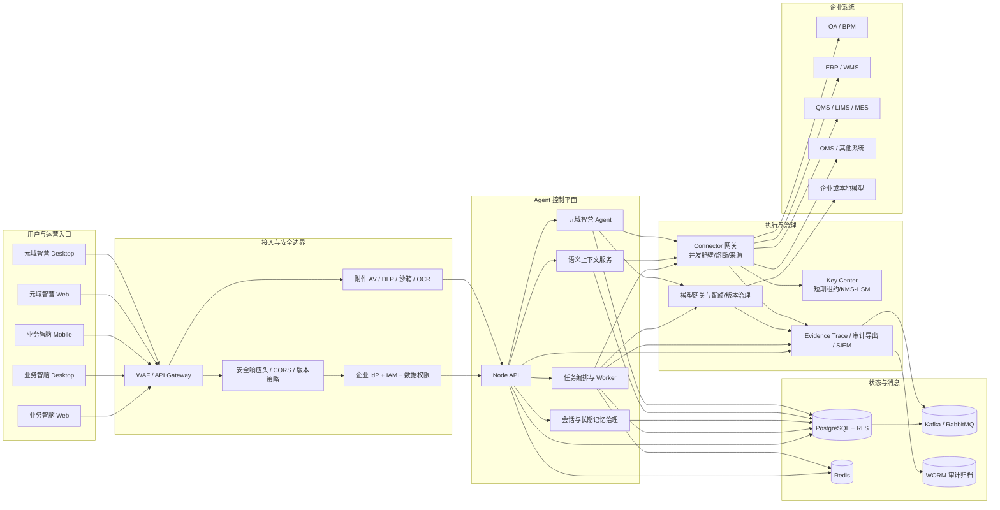
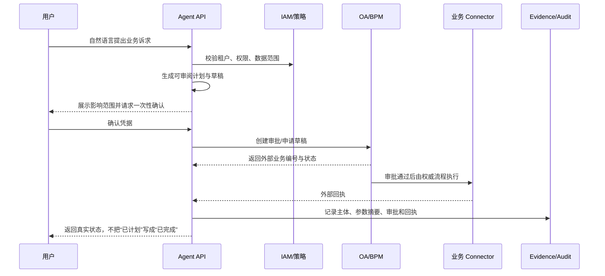

# 元域智脑生产架构与运行说明

> 版本：v1.0　更新日期：2026-09-01　状态：生产适配基线，仍需企业环境验收

## 1. 架构目标与边界

元域智脑由业务智脑与元域智营端两类产品入口组成。业务智脑只处理经授权的业务查询、分析和任务；元域智营 Agent 用于发现数据源、构建元对象/元模型、评审 Diff 和发布语义版本。两端共享身份、权限、审计、模型与连接器治理能力，但不共享角色权限，也不允许元域智营能力从业务端直接调用。

当前仓库可完成本地 Mock 闭环及生产适配开发，不等于已接入企业生产环境。企业 IdP、真实 OA/ERP/MES/WMS/LIMS/QMS/OMS、KMS/HSM、高可用 PostgreSQL、Redis、Broker、SIEM、内容安全平台、证书与签名体系仍需现场物料和联合验收。

## 2. 整体架构图

## 3. 关键数据流

### 3.1 只读分析

1. 客户端携带企业会话、客户端类型和版本调用 API。
2. API 验证身份、租户、角色、组织数据范围及最低客户端版本。
3. 编排器把自然语言转换为受控计划；附件先经过 AV、DLP、沙箱和安全 OCR。
4. 语义服务按授权范围解析业务对象和关系，连接器只接收裁剪后的查询，不接收原始 Prompt。
5. 模型网关校验模型白名单、主体日限额、并发和预算；生成内容引用数据来源。
6. 拒绝、检索、模型调用、工具调用和结果全部进入可关联证据链。

### 3.2 写入与审批

## 4. 服务、端口与依赖

| 组件 | 默认端口 | 生产强依赖 | 就绪条件 |
|---|---:|---|---|
| Node API | 3001 | IdP、PostgreSQL、Key Center | 强依赖可用且迁移版本受支持 |
| Key Center | 3010 | Vault/云 KMS/HSM、mTLS | Provider 可用且工作负载身份有效 |
| Semantic Context | 3011 | 持久化图/索引、IAM | 租户隔离与权限裁剪有效 |
| 管理 Web | 5173（开发） | 同源 API/企业 SSO | 静态资源与 API 兼容 |
| 元域智营 Web | 5174（开发） | Semantic Context/API | 版本、权限与发布门禁可用 |
| Mobile Web | 5175（开发） | API、MDM/MAM | 设备合规与版本受支持 |
| Desktop Web/Electron | 5184（开发） | API、代码签名/分发 | 可信导航、版本和签名有效 |
| PostgreSQL | 5432 | TLS、备份、监控 | migration checksum、RLS、主从状态正常 |
| Redis | 环境定义 | TLS、认证、集群 | 延迟、容量和副本状态正常 |
| Kafka/RabbitMQ | 环境定义 | TLS、工作负载身份 | Topic/Exchange、消费者与积压正常 |

## 5. 生产安全基线

- `NODE_ENV=production`，关闭 Demo Role Header、Mock 身份、Mock Connector 和 Demo KMS。
- API 置于同源 Gateway 后，启用 CSP、HSTS、点击劫持防护、CORS Allowlist、速率限制和请求体限制。
- Secret 仅以 KMS 引用或工作负载身份注入；不进入镜像、前端、日志、工单或聊天记录。
- 数据库按租户强制 RLS，审计仓只追加并使用 KMS/HSM 签名、可信时间戳及 WORM 保留。
- 生产多模态扫描模式为 `required`，扫描服务不可用时失败关闭。
- 连接器启用短期凭据、超时、并发舱壁、熔断、幂等、来源标记和真实回执。
- 模型必须精确匹配批准的供应商/模型版本，并执行并发、日调用量、Token 和成本门禁。

## 6. 部署顺序

1. 校验网络、DNS、证书、KMS 引用、数据库备份和 migration checksum。
2. 部署 PostgreSQL、Redis、Broker、WORM 审计存储等有状态依赖。
3. 部署 Key Center、企业身份适配和 Semantic Context。
4. 应用数据库迁移，再部署 API、领域事件/运行时/编排/审计 Worker。
5. 部署管理 Web、元域智营端和业务智脑各客户端。
6. 依次验证 liveness、readiness、身份/撤权、只读连接器、确认/审批、外部回执、SIEM 和证据链。
7. 首个生产写流程必须双人观察并与源系统对账。

详细命令、失败处置和回滚条件见 [部署、回滚与故障处置手册](DEPLOYMENT_ROLLBACK_RUNBOOK.md)。

## 7. 资产与证书准备清单

- 企业域名、内外网 DNS、Gateway/WAF、出口白名单与网络策略。
- Web TLS、服务间 mTLS CA/证书、桌面/移动签名证书及更新清单签名证书。
- IdP issuer、client、JWKS、tenant、Scope、回调地址和分角色测试账号。
- OA/ERP/MES/WMS/LIMS/QMS/OMS 沙箱地址、接口文档、字段字典、错误码、限流、测试数据、回调地址和服务账号。
- PostgreSQL/Redis/Broker/SIEM/KMS/HSM/内容安全/OCR 的地址、工作负载身份、容量与 SLA。
- 组织、人员、角色、数据范围、审批流、值班表、告警路由和合规保留策略。

## 8. 当前完成度声明

已完成代码级生产适配基线：安全响应头、模型与连接器治理、审计导出和检测、PostgreSQL migration v4、内容安全适配器、多端版本门禁、弱网安全重试、负载/稳定性工具、SBOM/SAST/SCA/Secret/镜像/IaC 门禁及非 root 容器。尚未完成的事项必须在真实企业环境中验收，不应以 Mock 或适配器存在替代上线签字。
