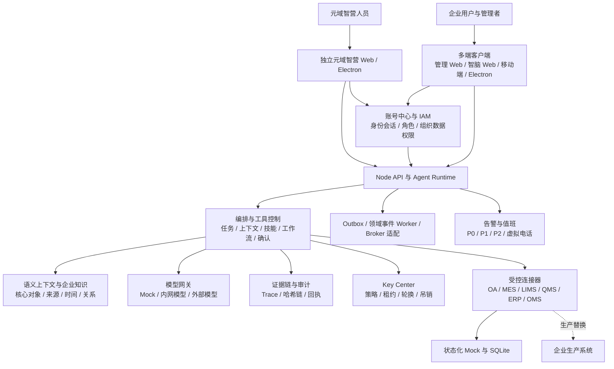

# 元域智脑整体平台介绍说明

> 文档版本：v1.0  
> 更新日期：2026-09-03（目录与现状校准修订）  
> 当前状态：Demo 可运行基线 / 生产化准备阶段  
> 适用对象：企业管理层、业务负责人、产品经理、架构师、研发、测试、实施、运维与安全团队

## 1. 文档目的

本文档从产品、业务、数据、技术、安全和实施六个视角介绍“元域智脑”平台，统一回答以下问题：

- 平台解决什么问题，面向哪些用户，核心价值是什么；
- 管理 Web、智脑 Web、移动端和 Electron 各自承担什么职责；
- Agent、权限、语义上下文、证据链、告警、连接器和密钥中心如何协同；
- 当前 Mock 演练环境已经具备哪些能力，哪些能力仍属于生产化建设项；
- 从当前开发基线进入企业生产环境，需要沿什么路径推进。

本文是平台级总览，不替代各模块的需求、API、架构、安全和部署专项文档。

## 2. 平台概述

### 2.1 一句话定位

元域智脑是一套企业 Agent 工作台与元域智营平台：它把人员、组织、业务对象、企业系统和大模型连接在统一的权限、工作流和证据链之下，让用户通过自然语言完成跨系统查询、分析、草稿、审批和受控日常工作。业务智脑服务员工，独立元域智营 Agent 服务建模与运营人员。

### 2.2 建设背景

企业通常同时运行 OA/BPM、ERP、WMS、MES、LIMS、QMS、OMS 等系统。数据分散、口径不一、跨部门协作依赖人工传递，业务事件难以形成统一视图。当前默认演练选择生产、质量、采购、供应、履约与门店场景，产品并不限定于单一行业。直接将大模型接入业务系统会带来权限越界、提示词注入、敏感数据泄露、错误写入和结果不可追溯等风险。

元域智脑的核心思路不是让模型直接控制企业系统，而是在模型与业务系统之间建立受控 Agent 层：先识别身份与数据范围，再检索可引用证据；先形成计划与草稿，再经过确认和审批；每个步骤生成可校验的执行记录。

### 2.3 当前建设阶段

当前仓库已经形成可运行的 Demo 基线，并使用状态化 Mock Connector 与本地 SQLite 跑通主要流程。2026-09-03 的质量检查与各端构建通过，详见第 11 节。当前版本适合产品演示、流程验证、接口契约设计、安全基线验证和多人协同开发，但尚不满足真实生产上线条件。

## 3. 平台目标与设计原则

### 3.1 建设目标

1. 建立跨业务系统的统一智能入口，减少用户在多个系统间切换和手工汇总。
2. 将企业数据、组织权限、业务流程和模型能力组合为可治理的 Agent 能力。
3. 让每次回答、建议、确认、审批和执行都能解释、审计和追溯。
4. 支持移动端、浏览器和桌面应用的一致体验，满足办公、现场和管理场景。
5. 通过标准连接器和模块化边界，从 Mock 平滑替换为真实企业系统。

### 3.2 设计原则

- **服务端可信**：权限、工具、参数、工作流和确认令牌均由服务端校验，客户端只负责展示和交互。
- **默认拒绝**：身份、权限、组织范围、核心对象或审批条件缺失时失败关闭。
- **模型不等于执行器**：模型输出只用于理解、总结和规划，不能直接代表业务写入成功。
- **先读后写、先草稿后审批**：高风险动作必须经过确认、审批和业务系统回执。
- **证据优先**：回答引用授权后的业务证据，并记录来源、时间、对象和授权上下文。
- **凭据不出边界**：客户端和模型不接收真实系统密钥，连接器只使用短期租约或不透明句柄。
- **多端协议一致**：移动端、智脑 Web 和 Electron 共享 Agent SDK 与 Workbench，减少能力漂移。
- **Mock 与生产隔离**：模拟数据、模拟回执和真实系统必须通过环境门禁彻底隔离。

## 4. 总体架构



### 4.1 分层职责

| 层级 | 主要组件 | 核心职责 | 明确边界 |
| --- | --- | --- | --- |
| 交互层 | 管理 Web、智脑 Web、移动端、Electron | 登录、对话、多任务、告警、确认、待办、证据展示 | 不保存系统或模型密钥，不直接写企业系统 |
| 身份与策略层 | 账号中心、IAM、组织与权限中心 | 身份、会话、角色、页面/按钮权限、组织数据范围 | 不采信客户端自报角色或组织 |
| Agent 控制层 | 编排、技能、工具注册、业务门禁、上下文压缩 | 意图路由、检索、计划、确认、草稿、受控执行 | 不允许模型自由构造工具或绕过审批 |
| 语义与证据层 | 语义上下文、知识、世界模型、Evidence Trace | 组织授权事实、关系、来源、时间和决策证据 | 不替代身份授权，不承担业务写入 |
| 凭据控制层 | Key Center、KMS/Vault/HSM 适配边界 | 短时租约、句柄、轮换、吊销与审计 | 不向客户端或模型返回密钥明文 |
| 集成与事件层 | MCP/系统连接器、Outbox、Worker、Broker 适配 | 读取、草稿写入、事件发布、重试与回放 | 生产写入必须受权限和工作流约束 |
| 数据与运行层 | SQLite Demo、PostgreSQL 适配、Redis/Broker 规划 | 状态、事务、幂等、恢复、扩展 | SQLite 仅为本地演练基线 |

## 5. 产品形态与用户入口

| 产品端 | 目标用户 | 主要能力 | 当前定位 |
| --- | --- | --- | --- |
| 管理 Web | 管理层、运营、IAM、Agent 管理员、安全与实施人员 | 运营总览、风险中心、世界模型、模型与 Key 配置、模拟运行、权限与审计 | 平台控制面与治理入口 |
| 元域智营端 | 建模、实施与数据运营人员 | 自然语言/附件建模、候选发现、人工校对、版本发布与巡检 | 独立 Agent，支持 Web 与 Electron；不借用员工业务权限 |
| 智脑 Web | 办公用户、业务负责人、分析人员 | 多任务对话、业务分析、告警处置、确认卡、回执、证据链 | 浏览器内的员工智脑工作台 |
| 移动端 | 现场人员、值班人员、移动管理者 | 告警、文字/语音输入、材料上传、任务与待办、确认执行 | 移动场景的统一 Agent 入口 |
| 智脑 Electron | Windows 办公用户 | 共享智脑交互，并提供受控文件、工作区读取、HTTPS 打开与剪贴板工具 | 企业桌面工作台；不是任意电脑控制器 |

三类智脑客户端共同使用 `@healthcare-ai/agent-sdk` 和 `@healthcare-ai/agent-workbench`。登录、会话、任务、证据、确认和回执协议保持一致；差异由屏幕尺寸、桌面容器能力和交互方式决定。元域智营端使用独立 SDK 和权限路径，不把模型建设能力直接开放给业务智脑。

## 6. 核心业务能力

### 6.1 智脑 Agent 运行时

- 支持多任务窗口并行，每名用户默认最多 8 个活跃任务；任务独立保存上下文、状态和证据。
- 实际上下文上限取模型 Provider 窗口和产品预算的较小值；产品预算配置不表示当前本地模型具有相同上下文容量，应按实际部署模型核对。
- 达到约 70% 预算时触发自动压缩，约 85% 时执行强制控制；默认保留最近 12 条安全消息。
- 摘要带版本和哈希；角色、组织数据范围或权限指纹变化时，相关上下文和长期记忆必须失效或重新授权。
- 服务端工具注册表定义工具 ID、Scope、Domain 与输入 Schema；未知工具、未知参数和 Schema 外字段全部拒绝。
- 对错误路径、违规操作、缺少对象或超出权限的请求，智脑给出原因、风险和合规替代建议。

### 6.2 核心元对象与世界模型

平台以五个核心元对象作为跨系统业务锚点：

| 核心对象 | 权威来源示例 | 典型用途 |
| --- | --- | --- |
| 人员（Person） | OA、账号中心、企业 IdP | 责任人、组织、角色、技能、审批身份、操作审计 |
| 原材料（RawMaterial） | ERP、SRM、LIMS、WMS | 采购、库存、批次、COA、检验、供应商质量 |
| 产品（Product） | PLM、MES、LIMS、ERP、QMS、OMS | 配方、生产、放行、销售、投诉、召回 |
| 设备（Equipment） | MES、EAM、IoT | 工艺、产能、维护、校准、异常影响 |
| 门店（Store） | MDM、OMS、POS、ERP | 区域、营业状态、库存、订单、履约、客诉、店内设备 |

门店统一使用 `Store.store_id`，并绑定权威 `organizationId`。涉及门店数据的查询和动作必须与当前主体的组织数据范围求交集。业务流程至少关联一名人员以及与目标直接相关的业务对象；对象不完整时只允许保存草稿，不能提交审批或执行写入。

### 6.3 身份、角色与数据权限

- 支持平台账号、Mock OA/BPM 登录和企业 OIDC Bearer 验证边界。
- 权限配置覆盖页面、按钮和服务端 API；隐藏按钮不是授权，关键写接口必须再次校验有效权限。
- 人员可拥有多个角色，执行时选择真正持有目标按钮权限的有效角色。
- 数据权限与组织架构绑定，支持 `SELF`、`CURRENT_ORG`、`ORG_AND_DESCENDANTS`、`SELECTED_ORGS`、`ALL` 五类范围。
- 权限撤销后，客户端采用可见态轮询和权限代际阻止旧响应回填；服务端按最新策略版本失败关闭。
- Agent 执行继续绑定原任务的租户、主体、角色、会话、设备、命令、有效期和一次性确认令牌。

### 6.4 语义上下文与知识治理

语义上下文服务以五个核心对象为锚点，将已经过权限裁剪和脱敏的事实组织为带来源、发生时间、采集时间、关系与冲突信息的上下文图。它用于检索、影响分析、引用和决策溯源，不负责用户认证、最终授权、密钥保存或业务写入。

平台同时提供 OA 元模型和世界模型模板治理。前者描述组织、人员、岗位、业务角色、审批流与待办；后者描述对象、关系、规则、数据来源和发布版本。模型配置采用草稿、校验、发布流程，减少配置误变更。

元域智营 Agent 可以从自然语言和受控附件形成对象、关系与映射建议，借助 Semantica 的候选结构与来源证据辅助人工校对。模型校对、Schema Critic、Diff、版本和巡检位于独立运营入口，发布仍受权限与人工确认控制。图服务健康状态与图数据导入情况应分别验证。

### 6.5 模型接入与配置治理

模型网关支持 Mock、OpenAI、DeepSeek、兼容接口和本地模型的适配边界。后台管理端提供模型连接配置入口，但模型 Key 不应由浏览器明文持久化；生产环境应通过 Key Center 与 Vault/KMS/HSM 注入短期租约或句柄。

外部模型必须返回严格的 `agent-summary.v1` JSON。服务端会再次校验未知字段、执行声明、提示词回显、密钥、脚本和敏感内容。没有服务端执行回执支撑的“已执行”声明不会被视为真实执行结果。

### 6.6 告警、值班与虚拟电话

| 级别 | 含义 | 默认处理方式 |
| --- | --- | --- |
| P0 | 紧急事件，需要尽快处理 | 立即通知责任人，进入升级策略，可自动触发虚拟电话 |
| P1 | 中等级别告警 | 进入责任人队列与时限跟踪，必要时升级 |
| P2 | 低风险告警 | 聚合展示、观察与计划性处置 |

告警编排根据组织责任人、值班表、渠道和升级策略生成事务 Outbox。当前 P0 电话采用 Mock Provider 完成语音拨打演练；DTMF 按键只表示送达确认，不授予业务审批权。生产环境需要接入真实电话 Provider、号码治理、通话模板、失败重拨、录音与隐私合规能力。

### 6.7 证据链与可追溯执行

每次 Agent 任务都会生成独立 Trace，按时间顺序记录输入安全、意图路由、身份与授权、证据检索、只读工具、模型调用或安全跳过、计划、用户确认、写工具和业务回执。即使请求被拒绝、需要澄清、确认失败、重复执行或无权限，仍保留结果明确的记录。

事件通过 SHA-256 前序哈希形成链式关系，Trace Manifest 保护 Run、租户、主体、角色、状态和头哈希；读取时实时校验。当前 SQLite 基线能够发现篡改，生产环境仍需迁移到只追加审计仓、WORM 存储、可信时间源和 KMS/HSM 数字签名。

### 6.8 密钥与凭据控制

Key Center 管理连接器和模型凭据的策略、短时租约、轮换、吊销与审计。客户端、模型和普通业务服务不接收真实密钥明文。当前进程内适配器用于 Demo 兼容，并提供独立 `/v1` 控制面契约；生产必须独立部署，通过 mTLS、SPIFFE 或云工作负载身份调用真实 Vault/KMS/HSM。

## 7. 典型业务闭环

### 7.1 告警到处置

1. MES、QMS、OMS 等连接器或 Mock 场景产生领域事件。
2. 告警编排根据规则确定 P0/P1/P2、责任组织、责任人与升级策略。
3. P0 立即触发站内通知和虚拟电话演练，其他级别进入相应队列。
4. 用户在任一智脑端打开告警，要求分析影响、查看证据并形成建议。
5. Agent 在权限范围内检索核心对象、业务事实和历史证据，生成计划。
6. 如涉及业务写入，系统创建草稿、确认卡或审批工作项。
7. 审批通过后由受控工具调用连接器，保存系统回执并更新证据链。

### 7.2 自然语言到受控业务动作

1. 用户提交文字、语音或受限业务材料。
2. 系统校验身份会话、设备、附件类型、请求大小和提示词风险。
3. Agent 识别意图并检查所需核心对象是否完整。
4. IAM 计算角色、页面/按钮权限、组织数据范围和工作流授权。
5. 检索层只返回当前主体可访问的事实，并附加来源与授权上下文。
6. 模型生成结构化摘要和建议，服务端进行二次安全校验。
7. 只读问题直接返回带引用答案；高风险动作只生成草稿或待确认计划。
8. 用户确认与审批完成后，连接器执行允许的命令并返回真实业务回执。
9. 全链路写入 Evidence Trace，供多端查看和审计复核。

## 8. Mock 模拟运行环境

### 8.1 已覆盖的系统与数据

当前 Demo 通过 OA、MES、LIMS、QMS、ERP、OMS 状态化 Mock Connector 提供百条级业务数据和跨系统关联，覆盖人员组织、生产设备、质量检验、质量事件、采购库存、订单履约和门店等场景。页面与 Agent 不直接读取种子文件，而是通过连接器与 Repository 访问统一数据。

### 8.2 可演练场景

- 原材料质量异常及影响分析；
- 生产设备异常及生产风险；
- 供应与库存风险；
- 订单履约和门店运营风险；
- 模拟 OA 待办、审批与受控写回；
- 接口不可用、数据延迟、主数据冲突和恢复回放。

### 8.3 状态化特征

Mock 并非静态页面数据。场景启动后会生成事件、告警、审批、回执和连接器健康变化，关键状态写入本地 SQLite，API 重启后可恢复，并可通过受控命令重置。所有模拟来源和故障状态必须明确标记，不能伪装为生产事实。

## 9. 工程结构与模块边界

```text
demo-platform/
├─ frontend/                 管理 Web 与治理控制台
├─ apps/mobile/              移动智脑
├─ apps/desktop/             智脑 Web 与 Electron
├─ apps/semantic-operations-console/ 独立元域智营 Web 与 Electron
├─ packages/agent-sdk/       多端身份、设备与 API 协议
├─ packages/agent-workbench/ 多端共享智脑工作台
├─ packages/semantic-operations-sdk/ 元域智营认证与 API 协议
├─ packages/api-contracts/   共享 API/OpenAPI 契约
├─ backend/                  Node API、Agent、IAM、连接器与 Repository
├─ services/                 语义服务、Key Center、领域事件 Worker
├─ deploy/                   部署配置与环境模板
└─ docs/                     平台、模块、API、安全、部署与清单文档
```

平台按 11 个协作模块拆分：身份与访问控制、Agent 运行时、证据与审计、告警与值班、风险运营、采购协同、模型与语义治理、系统接入与模拟、密钥与凭据、多端客户端、平台运行基础。各模块在 `docs/modules/` 下维护需求、API、技术架构和交接文档，便于多人并行开发。

## 10. 安全与治理基线

### 10.1 提示词与内容安全

- 对直接注入、间接注入、编码混淆、越权请求、提示词回显和数据泄露进行确定性检测。
- OCR、PDF、图片和外部检索内容一律视为不可信上下文，不作为授权依据。
- 附件入口校验数量、大小、MIME、魔数和文件名，并对支持格式执行有界文本提取。OCR 和内容安全依赖配置的服务，原文出域受策略控制；附件文字不能作为写操作授权依据。
- 自动长期记忆默认关闭；安全输入只保留审计 Run，权限变化会触发上下文失效。

### 10.2 业务执行安全

- 客户端只能确认服务端原任务已经提出的命令，不能更换工具或追加参数。
- 高风险动作必须满足身份、角色、数据范围、核心对象、业务权限、工作流、确认和租约的交集。
- 电话按键、模型文本和 UI 显示均不能代替审批或系统回执。
- 连接器查询按服务端范围收窄，响应按同一主体重新过滤与脱敏。

### 10.3 审计与运营安全

- 权限、模型配置、Key 轮换、模拟场景、世界模型发布等管理动作进入审计。
- 告警、确认、审批、工具调用和连接器回执进入统一证据链。
- 生产环境需要对接 SIEM、不可篡改审计仓、可信时间源、日志脱敏和安全告警运营。

## 11. 当前验证基线

2026-09-03 已通过 `npm run quality`（lint、类型检查和全量 Node 回归）、管理 Web/元域智营/桌面/移动构建，以及迁移文件校验。数量以各测试命令当次输出为准，主要覆盖如下：

| 测试域 | 主要覆盖 |
| --- | --- |
| API / OpenAPI 与架构 | 共享协议、客户端兼容、模块依赖与边界约束 |
| 领域事件 | Outbox、Worker、Broker 适配 |
| Agent 与安全 | 身份、凭据、工具 Schema、注入、模型回答与核心对象 |
| 证据链 | Trace、哈希链、拒绝与回执 |
| 会话与任务 | 多任务、压缩、权限指纹、长任务与编排 |
| 告警与电话 | 分级、路由、升级、Mock 通话 |
| 权限与客户端 | IAM、页面/按钮、数据权限、前端门禁 |
| 语义与桌面 | 运营任务门禁、布局、受控本机执行及设备协议 |
| 持久化与学习 | PostgreSQL 适配、SQLite 恢复、授权信号与撤销 |

该结果是开发基线，不等同于企业环境验收、渗透测试、性能测试、灾备演练或生产签字。

## 12. 当前能力与生产边界

| 领域 | 当前 Demo | 生产环境必须补齐 |
| --- | --- | --- |
| 身份 | 平台账号、Mock OA、OIDC Bearer 验证边界 | 企业 IdP 授权码 + PKCE、MFA、续期、全局注销、JML |
| 数据库 | SQLite 状态化持久化，PostgreSQL Schema/适配基线 | PostgreSQL 集群、RLS、迁移、备份、审计、容量治理 |
| 缓存与任务 | 进程内控制与 Outbox/Worker 基线 | Redis、正式 Broker、分布式限流、长任务恢复与幂等 |
| 企业系统 | OA/MES/LIMS/QMS/ERP/OMS Mock | 真实接口、字段映射、网络、认证、沙箱和对账 |
| 模型 | Mock 与多 Provider 适配、结构化输出校验 | 供应商准入、版本固定、配额、评测、数据条款和退出方案 |
| 密钥 | 进程内适配与独立 API 契约 | 独立 Key Center、Vault/KMS/HSM、工作负载身份 |
| 语义 | Node 投影与 Python 服务边界 | 独立部署、持久化图/索引、租户隔离、mTLS |
| 审计 | SQLite Trace、哈希链与篡改检测 | 只追加审计仓、WORM、可信时间、数字签名、SIEM |
| 电话/推送 | Mock 电话与站内通知 | 真实电话、短信、APNs/FCM、隐私与送达对账 |
| 客户端 | Web、移动构建、Electron 基线 | 代码签名、自动更新、MDM、证书固定、崩溃与遥测治理 |

生产待办统一维护于 `docs/operations/PRODUCTION_TODO_CHECKLIST.md`，本文不再复制容易过期的数量。所有 P0 阻断项关闭并完成签字前，不得连接生产系统或处理真实敏感数据。

## 13. 推荐实施路径

### 阶段 A：范围与治理基线

确定首期组织、用户、场景、数据、读写动作和明确不做事项；建立模块 Owner、数据 Owner、系统 Owner、审批责任和安全责任；完成数据分类、合规评估、动作白名单与 SLA。

### 阶段 B：生产基础设施

完成企业 IdP、PostgreSQL、Redis、消息队列、Key Center、Vault/KMS/HSM、日志审计、SIEM、网络与证书体系；建立开发、测试、预生产、生产环境隔离。

### 阶段 C：真实系统接入

按 OA、MES、LIMS、QMS、ERP、OMS 的优先级收集接口、字段、主数据、认证、网络、同步、幂等和审批资料；先接只读查询，再接草稿和审批，最后接受控写入。

### 阶段 D：Agent 与安全验证

建立真实业务评测集、提示词攻击集、越权测试、引用完整率、拒答准确率、工具成功率和人工复核机制；完成文件安全、OCR、DLP、模型版本门禁与红队测试。

### 阶段 E：试点与推广

选择低风险、证据明确、可人工复核的业务场景试点；通过灰度、双轨核对、回滚和运营看板验证效果，再逐步扩大组织、场景和写入范围。

## 14. 业务价值

- **统一入口**：将跨系统查询、分析、告警和协作集中到多端智脑。
- **决策提速**：围绕人员、原材料、产品、设备、门店快速聚合影响证据。
- **风险受控**：模型能力被身份、数据权限、工具 Schema、工作流和确认机制约束。
- **过程可审计**：回答、拒绝、确认、审批、执行和回执均有证据链。
- **开发可扩展**：模块边界、共享契约、Repository 和 Connector 适配便于多人协作和生产替换。
- **演练可复现**：状态化 Mock 能在不连接真实系统的情况下验证跨系统流程、故障和恢复。

## 15. 推荐演示脚本

1. 使用演示账号登录管理 Web，查看运营总览、P0/P1/P2 告警与系统健康。
2. 在模拟运行中心启动“原材料质量异常”或“订单履约风险”场景。
3. 切换到智脑 Web、移动端或 Electron，打开新告警并要求智脑分析影响。
4. 展开证据链，核对来源系统、核心对象、授权上下文、模型步骤和告警证据。
5. 让智脑提出受控业务动作，展示核心对象校验、按钮权限、组织数据范围和确认卡。
6. 完成模拟确认或 OA 审批，查看 Mock 写回、业务回执与哈希链更新。
7. 注入连接器延迟或不可用故障，展示智脑如何标记证据不完整并给出恢复建议。
8. 返回管理 Web 查看权限审计、模型配置、Key 租约、告警路由和运行统计。

## 16. 关联文档

- `README.md`：项目入口、启动、构建和当前能力摘要；
- `docs/architecture/ARCHITECTURE.md`：详细系统架构；
- `docs/architecture/CORE_META_OBJECTS.md`：五个核心元对象与流程约束；
- `docs/architecture/ZHINAO_AGENT_ARCHITECTURE_V2.md`：智脑 Agent 架构；
- `docs/architecture/IAM_PERMISSION_CENTER.md`：角色、按钮和组织数据权限；
- `docs/architecture/AGENT_PROMPT_SECURITY.md`：提示词与内容安全；
- `docs/architecture/AGENT_EVIDENCE_TRACE.md`：执行证据链；
- `docs/architecture/ALERTING_VIRTUAL_VOICE.md`：告警与虚拟电话；
- `docs/development/MOCK_SIMULATION_RUNTIME.md`：状态化 Mock 运行时；
- `docs/architecture/KEY_CENTER_MICROSERVICE.md`：密钥与凭据边界；
- `docs/architecture/SEMANTIC_CONTEXT_MICROSERVICE.md`：语义上下文服务；
- `docs/operations/PRODUCTION_TODO_CHECKLIST.md`：生产化与投产后 Checklist；
- `docs/modules/README.md`：模块化协作文档中心。

## 17. 术语说明

| 术语 | 说明 |
| --- | --- |
| Agent | 在权限和工具约束下完成理解、检索、规划、确认与执行协同的软件运行时 |
| Workbench | 移动端、智脑 Web 和 Electron 共享的智脑交互组件 |
| Core Meta Object | 跨系统统一识别和约束业务流程的核心元对象 |
| Evidence Trace | 一次任务从输入到结果的结构化证据记录 |
| Outbox | 与业务事务共同保存、再异步发布的事件可靠交付模式 |
| Connector | 访问 OA、MES、LIMS、QMS、ERP、OMS 等系统的受控适配器 |
| Key Center | 负责凭据策略、租约、轮换、吊销和审计的控制面 |
| WORM | Write Once Read Many，只写一次、多次读取的不可篡改存储能力 |
